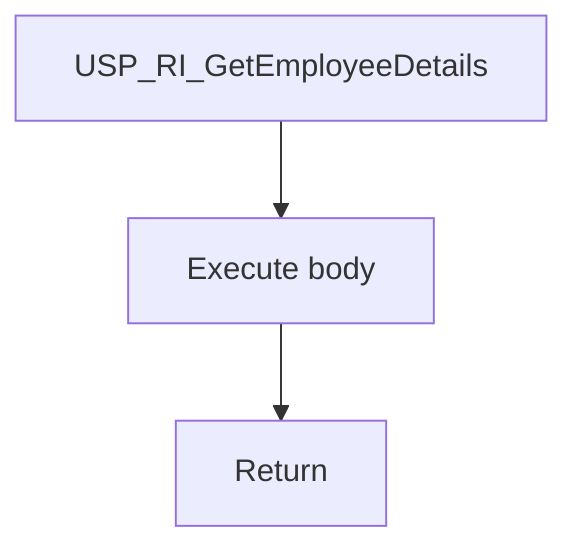

# USP_RI_GetEmployeeDetails

## What it does

Returns employee profile plus current allocation context used to seed the Initiate Reallocation form.

## Parameters

| Name | Direction | What it is for |
|---|---|---|
| `@EmployeeID` | in | May be varchar in callers; employee id(s) |
| `@EmployerID` | in | Employer id(s) |

## Call sequence

`Sp_OpenEncryptionKeys`, `SP_CloseEncryptionKey`, `Fn_GetEmployeeName`.

## Callers

Application caller: RA WebAPI `raDAL` from [Manage Allocation](/docs/guides/resource-allocation/manage-allocation) Initiate Reallocation / Notifications.

## Nested

`Sp_OpenEncryptionKeys`, `SP_CloseEncryptionKey`, `Fn_GetEmployeeName`.

## Steps

1. Script is `HRMS-DATABASE/HRMS-RESOURCEALLOCATION/STOREPROCEDURE/USP_RI_GetEmployeeDetails.sql`.
2. Returns employee profile plus current allocation context used to seed the Initiate Reallocation form.

## Tables

| Table | Read or write |
|---|---|
| `dbo.TEmployee / TEmployeeInfo / TORGChart / TOrgHierarchyDetails / TTitle` | read (synonym) |
| `dbo.TRESOURCEALLOCATION` | read |

## Unresolved calls

None.

## Flow

