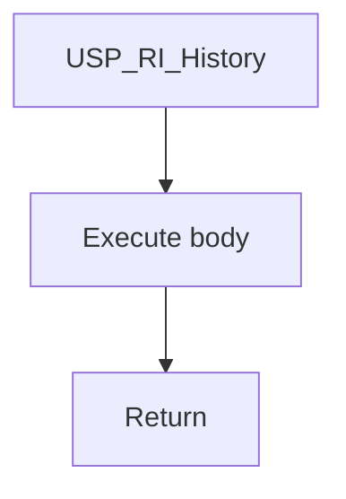

# USP_RI_History

## What it does

Returns status-history rows for one reallocation initiate id.

## Parameters

| Name | Direction | What it is for |
|---|---|---|
| `@ReallocationInitiateID` | in | Request id |

## Call sequence

`Fn_GetEmployeeName`.

## Callers

Application caller: RA WebAPI `raDAL` from [Manage Allocation](/docs/guides/resource-allocation/manage-allocation) Initiate Reallocation / Notifications.

## Nested

`Fn_GetEmployeeName`.

## Steps

1. Script is `HRMS-DATABASE/HRMS-RESOURCEALLOCATION/STOREPROCEDURE/USP_RI_History.sql`.
2. Returns status-history rows for one reallocation initiate id.

## Tables

| Table | Read or write |
|---|---|
| `dbo.TReallocationInitiateStatusHistory` | read |

## Unresolved calls

None.

## Flow

