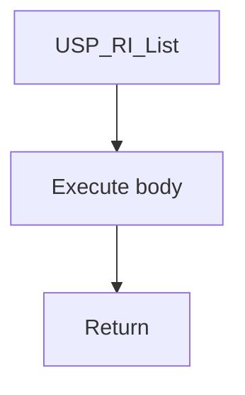

# USP_RI_List

## What it does

Lists reallocation-initiate rows for an employer (optional employee / id filter), with decrypted names and allocation context.

## Parameters

| Name | Direction | What it is for |
|---|---|---|
| `@EmployerID` | in | Employer |
| `@EmployeeID` | in | Optional employee filter |
| `@ReallocationInitiateID` | in | Optional request id |

## Call sequence

`Sp_OpenEncryptionKeys`, `SP_CloseEncryptionKey`, `Fn_GetEmployeeName`.

## Callers

Application caller: RA WebAPI `raDAL` from [Manage Allocation](/docs/guides/resource-allocation/manage-allocation) Initiate Reallocation / Notifications.

## Nested

`Sp_OpenEncryptionKeys`, `SP_CloseEncryptionKey`, `Fn_GetEmployeeName`.

## Steps

1. Script is `HRMS-DATABASE/HRMS-RESOURCEALLOCATION/STOREPROCEDURE/USP_RI_List.sql`.
2. Lists reallocation-initiate rows for an employer (optional employee / id filter), with decrypted names and allocation context.

## Tables

| Table | Read or write |
|---|---|
| `dbo.TReallocationInitiate` | read |
| `dbo.TReallocationInitiateStatusHistory` | read |
| `dbo.TRESOURCEALLOCATION` | read |
| `dbo.TEmployee / TEmployeeInfo` | read (synonym) |

## Unresolved calls

None.

## Flow

