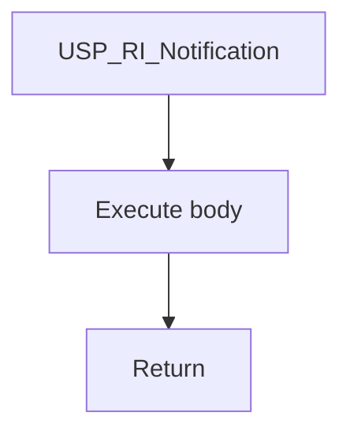

# USP_RI_Notification

## What it does

Returns pending reallocation notification rows for the Notifications tab (role-scoped across employer ids).

## Parameters

| Name | Direction | What it is for |
|---|---|---|
| `@EmployeeID` | in | Logged-in employee |
| `@EmployerIDs` | in | Employer id list |
| `@RoleType` | in | Role type A/M etc. |

## Call sequence

`Sp_OpenEncryptionKeys`, `Fn_GetEmployeeName`.

## Callers

Application caller: RA WebAPI `raDAL` from [Manage Allocation](/docs/guides/resource-allocation/manage-allocation) Initiate Reallocation / Notifications.

## Nested

`Sp_OpenEncryptionKeys`, `Fn_GetEmployeeName`.

## Steps

1. Script is `HRMS-DATABASE/HRMS-RESOURCEALLOCATION/STOREPROCEDURE/USP_RI_Notification.sql`.
2. Returns pending reallocation notification rows for the Notifications tab (role-scoped across employer ids).

## Tables

| Table | Read or write |
|---|---|
| `dbo.TReallocationInitiate` | read |
| `dbo.TEmployeeInfo` | read (synonym) |

## Unresolved calls

None.

## Flow

