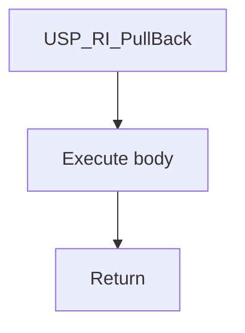

# USP_RI_PullBack

## What it does

Pulls back an in-flight reallocation initiate: updates status, writes history, and notifies workflow managers.

## Parameters

| Name | Direction | What it is for |
|---|---|---|
| `@ReallocationInitiateID` | in | Request id |
| `@Comment` | in | Pull-back comment |
| `@EmployeeID / @EmployerID / @UpdatedBy` | in | Actors |

## Call sequence

`USP_RI_StatusHistory_SaveUpdate`, `SP_CM_GetDataforRequestWorkFlows`, `Sp_InsHomePageNotificationCnts`, `FN_CM_GetMgrFromRequestWorkflows`, `FN_CM_GetApproverList`.

## Callers

Application caller: RA WebAPI `raDAL` from [Manage Allocation](/docs/guides/resource-allocation/manage-allocation) Initiate Reallocation / Notifications.

## Nested

`USP_RI_StatusHistory_SaveUpdate`, `SP_CM_GetDataforRequestWorkFlows`, `Sp_InsHomePageNotificationCnts`, `FN_CM_GetMgrFromRequestWorkflows`, `FN_CM_GetApproverList`.

## Steps

1. Script is `HRMS-DATABASE/HRMS-RESOURCEALLOCATION/STOREPROCEDURE/USP_RI_PullBack.sql`.
2. Pulls back an in-flight reallocation initiate: updates status, writes history, and notifies workflow managers.

## Tables

| Table | Read or write |
|---|---|
| `dbo.TReallocationInitiate` | write |
| `dbo.TModulePages / TWorkflowManagement / TWorkflowDetails` | read (synonym) |

## Unresolved calls

None.

## Flow

