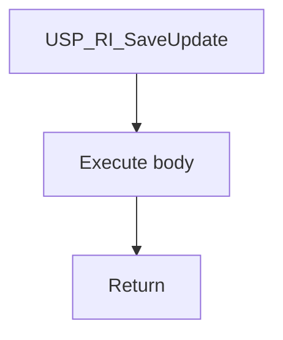

# USP_RI_SaveUpdate

## What it does

Inserts or updates a `TReallocationInitiate` row, writes status history, and may start workflow / homepage notifications for initiate-reallocation.

## Parameters

| Name | Direction | What it is for |
|---|---|---|
| `@ReallocationInitiateID` | in | 0/null = insert |
| `@EmployeeID / @EmployerID` | in | Subject |
| `@AllocationConfirmedBy … @Notes` | in | Reallocation field set |
| `@ReallocationStatus / @Comment` | in | Status and comment |
| `@IsDeleted` | in | Soft-delete flag |
| `@CreatedBy / @UpdatedBy` | in | Actors |

## Call sequence

`USP_RI_StatusHistory_SaveUpdate`, `SP_CM_GetWorkflowTreeXmlDetailsByPageTitle`, `SP_CM_GetDataforRequestWorkFlows`, `Sp_InsHomePageNotificationCnts`, `FN_CM_GetMgrFromRequestWorkflows`, `FN_CM_GetApproverList`.

## Callers

Application caller: RA WebAPI `raDAL` from [Manage Allocation](/docs/guides/resource-allocation/manage-allocation) Initiate Reallocation / Notifications.

## Nested

`USP_RI_StatusHistory_SaveUpdate`, `SP_CM_GetWorkflowTreeXmlDetailsByPageTitle`, `SP_CM_GetDataforRequestWorkFlows`, `Sp_InsHomePageNotificationCnts`, `FN_CM_GetMgrFromRequestWorkflows`, `FN_CM_GetApproverList`.

## Steps

1. Script is `HRMS-DATABASE/HRMS-RESOURCEALLOCATION/STOREPROCEDURE/USP_RI_SaveUpdate.sql`.
2. Inserts or updates a `TReallocationInitiate` row, writes status history, and may start workflow / homepage notifications for initiate-reallocation.

## Tables

| Table | Read or write |
|---|---|
| `dbo.TReallocationInitiate` | write |
| `dbo.TRESOURCEALLOCATION` | read |
| `dbo.TEmployeeInfo / TORGChart` | read (synonym) |

## Unresolved calls

None.

## Flow

