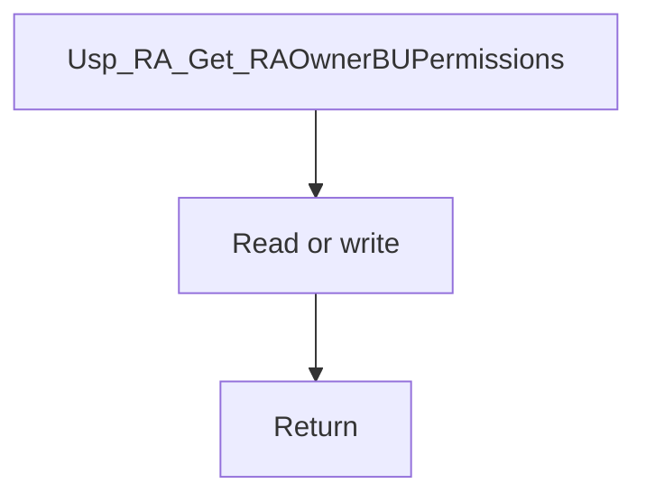

# Usp_RA_Get_RAOwnerBUPermissions

## What it does

Returns View/Edit/Confirm permission flags per business unit for the employee's resource allocation owner record.

## Parameters

| Name | Direction | What it is for |
|---|---|---|
| `@EmployeeId` | in | Owner employee id |

## Call sequence

Calls no other procedures or functions.

## Callers

Application caller: raProviderDAL GetRAOwnerBUPermissions from [Manage Allocation](/docs/guides/resource-allocation/manage-allocation).

## Nested

Calls no other procedures or functions.

## Steps

1. Script is `HRMS-DATABASE/HRMS-RESOURCEALLOCATION/STOREPROCEDURE/Usp_RA_Get_RAOwnerBUPermissions.sql`.
2. Returns View/Edit/Confirm permission flags per business unit for the employee's resource allocation owner record.

## Tables

| Table | Read or write |
|---|---|
| `dbo.TRESOURCE_ALLOCATION_OWNER` | read |
| `dbo.TRESOURCE_ALLOC_OWNER_BUSUNIT` | read |

## Unresolved calls

None.

## Flow

