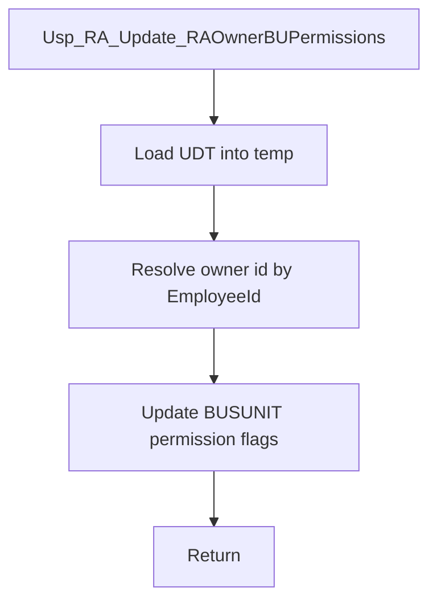

# Usp_RA_Update_RAOwnerBUPermissions

## What it does

Updates View / Edit / Confirm permission bits on `TRESOURCE_ALLOC_OWNER_BUSUNIT` for the RAS Provider identified by `@EmployeeId`, using a table-valued parameter of per-BU flags. Also clears soft-delete markers on matched rows.

## Parameters

| Name | Direction | What it is for |
|---|---|---|
| `@UDTResourceOwnerBUPermissions` | in | UDT rows of EmployeeId, BusinessUnitId, ViewPermission, EditPermission, ConfirmPermission |
| `@EmployeeId` | in | Owner employee id used to resolve `ResourceAllocationOwnerID` |

## Call sequence

Calls no other procedures or functions.

## Callers

No other procedure or function in `HRMS-RESOURCEALLOCATION` calls this object. Application caller: RA WebAPI `raProviderDAL.SaveResourceOwnerBUPermissions` from [Manage Access](/docs/guides/resource-allocation/manage-access).

## Nested

Calls no other procedures or functions.

## Steps

1. Script is `HRMS-DATABASE/HRMS-RESOURCEALLOCATION/STOREPROCEDURE/Usp_RA_Update_RAOwnerBUPermissions.sql`.
2. Copy the UDT into a table variable.
3. Resolve `@ALLOCATION_OWNER_ID` as `TOP 1 ResourceAllocationOwnerID` from `TRESOURCE_ALLOCATION_OWNER` for `@EmployeeId` (no employer filter).
4. Update matching `TRESOURCE_ALLOC_OWNER_BUSUNIT` rows’ permission columns and set `IsDeleted = 0`, clear delete audit.

## Tables

| Table | Read or write |
|---|---|
| `dbo.TRESOURCE_ALLOCATION_OWNER` | read |
| `dbo.TRESOURCE_ALLOC_OWNER_BUSUNIT` | write |

## Unresolved calls

None.

## Flow

