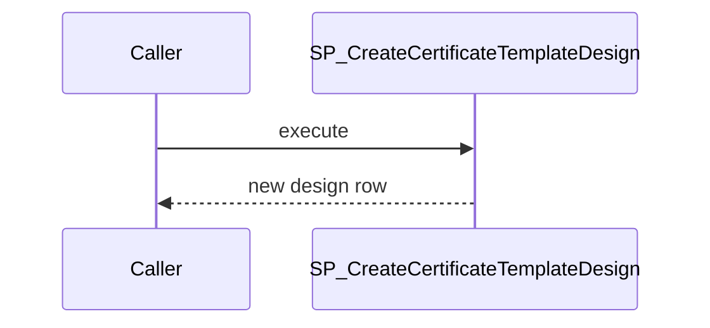
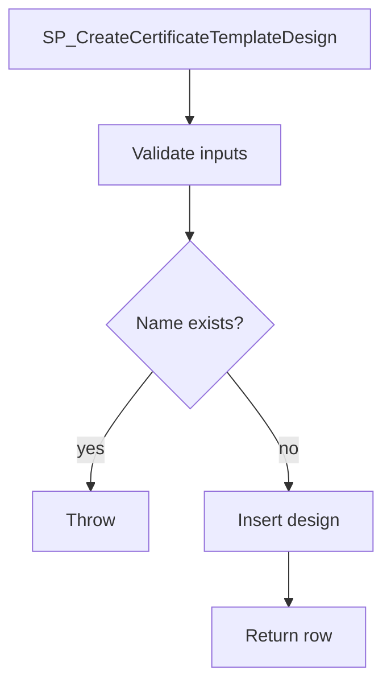

# SP_CreateCertificateTemplateDesign

## What it does

Inserts a new certificate custom template design into `TCertificateCustomTemplates`. Rejects duplicate names for the employer (including unique-constraint mapping). Returns the new row.

## Parameters

| Name | Direction | What it is for |
|---|---|---|
| `@EmployerId` | in | Employer scope |
| `@Name` | in | Template name |
| `@IssuingManagerEmployeeId` | in | Optional issuing manager employee id |
| `@IssuingManagerName` | in | Optional issuing manager name |
| `@DesignJson` | in | Design payload |
| `@CreatedByUserId` | in | Acting user |
| `@IsActive` | in | Active flag (default 1) |

## Call sequence

## Callers

No other procedure executes this object. App callers: Rewards_and_Recognition certificate-template-designs create → [Admin Console](/docs/guides/reward-and-recognition/admin-console).

## Nested

Calls no other procedures or functions.

## Steps

1. Script is `HRMS-DATABASE/HRMS-RewardNRecognition/STORED_PROCEDURE/SP_CreateCertificateTemplateDesign.sql`.
2. Validate employer, name, and user.
3. Throw if an active (non-deleted) template with the same name exists.
4. Insert row; return selected new row.
5. Map unique-key violations to duplicate-name error.

## Tables

| Table | Read or write |
|---|---|
| `dbo.TCertificateCustomTemplates` | read/write |

## Unresolved calls

None.

## Flow

