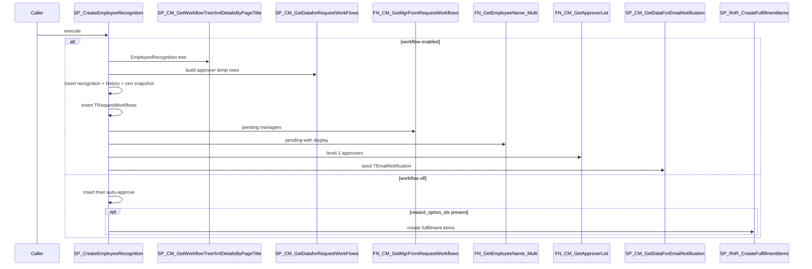
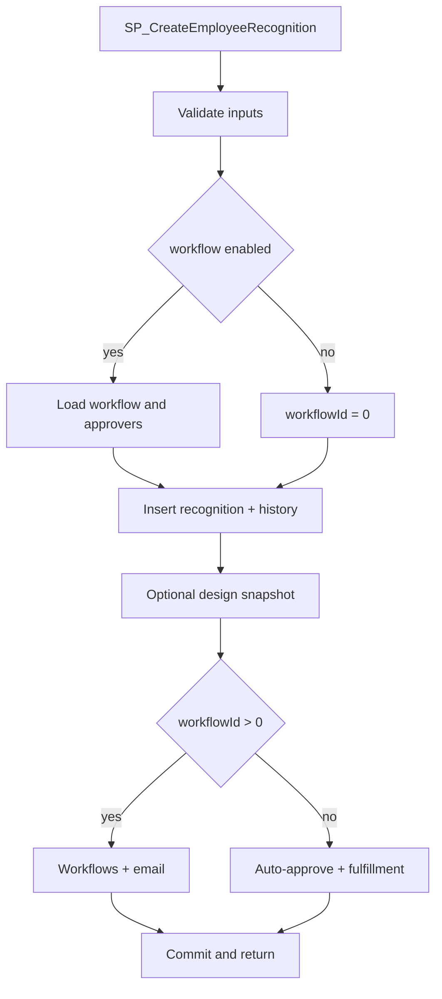

# SP_CreateEmployeeRecognition

## What it does

Creates one `TEmployeeRecognition` row (plus status history and optional certificate design snapshot). When `TRnR_WorkflowConfiguration` has EmployeeRecognition workflow on, it loads the HRMS workflow tree and approvers, inserts `TRequestWorkflows`, updates pending-with text, and seeds `TEmailNotification`. When workflow is off, it auto-approves, optionally calls `SP_RnR_CreateFulfillmentItems` for reward options, and snapshots certificate HTML/background/logo columns. Returns the new recognition as a SUCCESS result set. Budget hold/issue is not done here (caller is expected to run `SP_RnR_Budget_OnRecognitionSubmitted` afterward).

## Parameters

| Name | Direction | What it is for |
|---|---|---|
| `@employer_id` | in | Employer of the recognition. Must be greater than 0 |
| `@sender_employer_id` | in | Sender’s employer id stored on the row |
| `@sender_employee_id` | in | Giver. Must be greater than 0 |
| `@recipient_employee_id` | in | Recipient. Must be greater than 0 |
| `@recipient_business_unit_id` | in | Optional recipient BU id |
| `@recipient_business_unit_name` | in | Optional recipient BU name |
| `@recipient_location_id` | in | Optional recipient location id |
| `@recipient_location_name` | in | Optional recipient location name |
| `@award_type_id` | in | Award type. Must be greater than 0 |
| `@award_name` | in | Award display name snapshot |
| `@reward_option_id` | in | Optional single reward option id |
| `@reward_option_ids` | in | Optional JSON / list of reward option ids for fulfillment |
| `@points` | in | Points on the recognition |
| `@monetary_value` | in | Optional monetary value |
| `@title` | in | Optional recognition title |
| `@message` | in | Optional message body |
| `@status` | in | Initial status. Default `pending_approval` |
| `@is_featured` | in | Featured flag. Must be 0 or 1 |
| `@currency` | in | Optional currency code |
| `@created_by` | in | Actor employee id for history / workflow |
| `@core_values` | in | Optional JSON array of core values; validated with `ISJSON` when not null |

## Call sequence

## Callers

No other procedure or function in `HRMS-RewardNRecognition/STORED_PROCEDURE` executes this object. App callers live in the Rewards_and_Recognition backend that is not in this SourceCode checkout.

| Object | Kind | Page |
|---|---|---|
| Give Recognition React / RnR API | app | [Give Recognition](/docs/guides/reward-and-recognition/give-recognition) (host only; API not in checkout) |

## Nested

| Object | Kind | When | Page |
|---|---|---|---|
| `SP_CM_GetWorkflowTreeXmlDetailsByPageTitle` | procedure | workflow enabled | [SP_CM_GetWorkflowTreeXmlDetailsByPageTitle](/docs/database/hrms/SP_CM_GetWorkflowTreeXmlDetailsByPageTitle) |
| `SP_CM_GetDataforRequestWorkFlows` | procedure | workflow enabled | [SP_CM_GetDataforRequestWorkFlows](/docs/database/hrms/SP_CM_GetDataforRequestWorkFlows) |
| `FN_CM_GetMgrFromRequestWorkflows` | function | after workflow rows inserted | [FN_CM_GetMgrFromRequestWorkflows](/docs/database/hrms/FN_CM_GetMgrFromRequestWorkflows) |
| `FN_GetEmployeeName_Multi` | function | pending-with text | [FN_GetEmployeeName_Multi](/docs/database/hrms/FN_GetEmployeeName_Multi) |
| `FN_CM_GetApproverList` | function | before email notification | [FN_CM_GetApproverList](/docs/database/hrms/FN_CM_GetApproverList) |
| `SP_CM_GetDataForEmailNotification` | procedure | workflow enabled | [SP_CM_GetDataForEmailNotification](/docs/database/hrms/SP_CM_GetDataForEmailNotification) |
| `SP_RnR_CreateFulfillmentItems` | procedure | workflow off and reward option ids present | [SP_RnR_CreateFulfillmentItems](/docs/database/hrms-rewardnrecognition/SP_RnR_CreateFulfillmentItems) |

## Steps

In `HRMS-DATABASE/HRMS-RewardNRecognition/STORED_PROCEDURE/SP_CreateEmployeeRecognition.sql`:

1. Validate employer, sender, recipient, award type, `is_featured`, and optional `core_values` JSON.
2. Resolve Active `RedeemStatusID` from `TRedeemStatus`.
3. Read `IsWorkflowEnabled` for `EmployeeRecognition` from `TRnR_WorkflowConfiguration` (default 1 when missing).
4. If workflow on: EXEC workflow tree; require a workflow id; EXEC approver rows into `#TRequestWorkflows`; require at least one row.
5. Begin transaction; insert `TEmployeeRecognition` and initial `TEmployeeRecognitionStatusHistory` (`Request Submitted`).
6. If the award type has a certificate template, insert `TEmployeeRecognitionCertificateSnapshot` from `TCertificateCustomTemplates.design_json`.
7. If workflow on: insert `TRequestWorkflows`; set `CustomStatusInformation` via manager/name helpers; insert pending history; seed `TEmailNotification` via `SP_CM_GetDataForEmailNotification`.
8. If workflow off: set status `approved` / `Auto Approved`; insert Approved history; optionally `EXEC SP_RnR_CreateFulfillmentItems`; optionally copy certificate HTML/background/logo from `TCertificateTemplates` onto the recognition row.
9. Commit; return the new recognition with `Status = SUCCESS` and `StatusCode = 200`.
10. On error, rollback if needed and throw `50099`.

## Tables

| Table | Read or write |
|---|---|
| `dbo.TRedeemStatus` | read |
| `dbo.TRnR_WorkflowConfiguration` | read |
| `dbo.TEmployeeRecognition` | write |
| `dbo.TEmployeeRecognitionStatusHistory` | write |
| `dbo.TRecognitionAwardTypesMaster` | read |
| `dbo.TCertificateCustomTemplates` | read |
| `dbo.TEmployeeRecognitionCertificateSnapshot` | write |
| `dbo.TRequestWorkflows` | write |
| `dbo.TEmailNotification` | write |
| `dbo.TCertificateTemplates` | read |

## Flow

