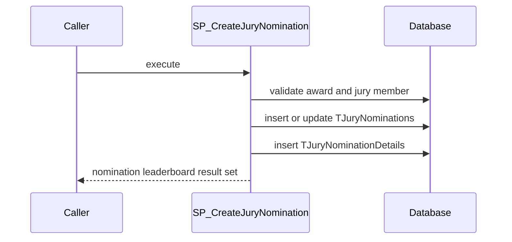
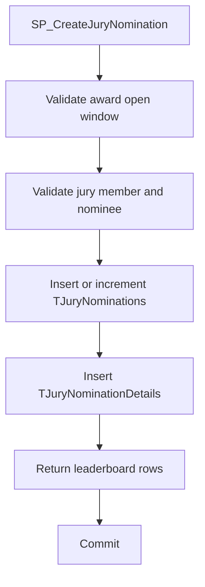

# SP_CreateJuryNomination

## What it does

Records a jury member's nomination for an open jury award inside a transaction. Validates the award is `nomination_open` and within the nomination window, that the caller is a jury member, that they are not nominating themselves, and that they have not already nominated. Inserts or increments `TJuryNominations`, inserts `TJuryNominationDetails`, then returns the award's nomination leaderboard rows (camelCase columns with nominee name/email and nomination-details JSON). Rolls back and rethrows on failure.

## Parameters

| Name | Direction | What it is for |
|---|---|---|
| `@JuryAwardId` | in | Target jury award id |
| `@NomineeId` | in | Employee id being nominated |
| `@NominationReason` | in | Reason text (max 1000) |
| `@JuryMemberEmployeeId` | in | Nominating jury member's employee id |
| `@EmployerId` | in | Employer scope for the award lookup |

## Call sequence

## Callers

No other procedure or function executes this object. App callers: `serviceNominateJuryAward` → `POST /rewards/admin/jury-awards/jury-nominations/:juryAwardId/nominate` from [Recognition Dashboard](/docs/guides/reward-and-recognition/recognition-dashboard) Nominate dialog. The service then calls `SP_GetJuryAwardById` separately to reload the award (not nested in this SP).

## Nested

Calls no other procedures or functions.

## Steps

1. Script is `HRMS-DATABASE/HRMS-RewardNRecognition/STORED_PROCEDURE/SP_CreateJuryNomination.sql`.
2. Begin transaction; load award status and nomination dates for employer.
3. Throw if award missing, not `nomination_open`, or outside the nomination window.
4. Resolve jury member row; throw if not a member, self-nominate, or already nominated.
5. Insert `TJuryNominations` or increment `nomination_count`.
6. Insert `TJuryNominationDetails` with reason.
7. Select leaderboard-shaped result set for the award; commit. On error, rollback and throw.

## Tables

| Table | Read or write |
|---|---|
| `dbo.TJuryAwards` | read |
| `dbo.TJuryMembers` | read |
| `dbo.TJuryNominations` | read/write |
| `dbo.TJuryNominationDetails` | read/write |
| `dbo.TEmployee` | read (synonym → HRMS) |

## Unresolved calls

None.

## Flow

