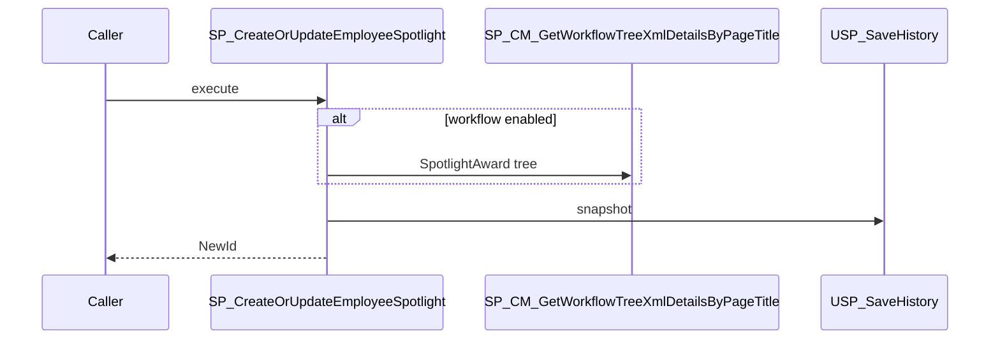
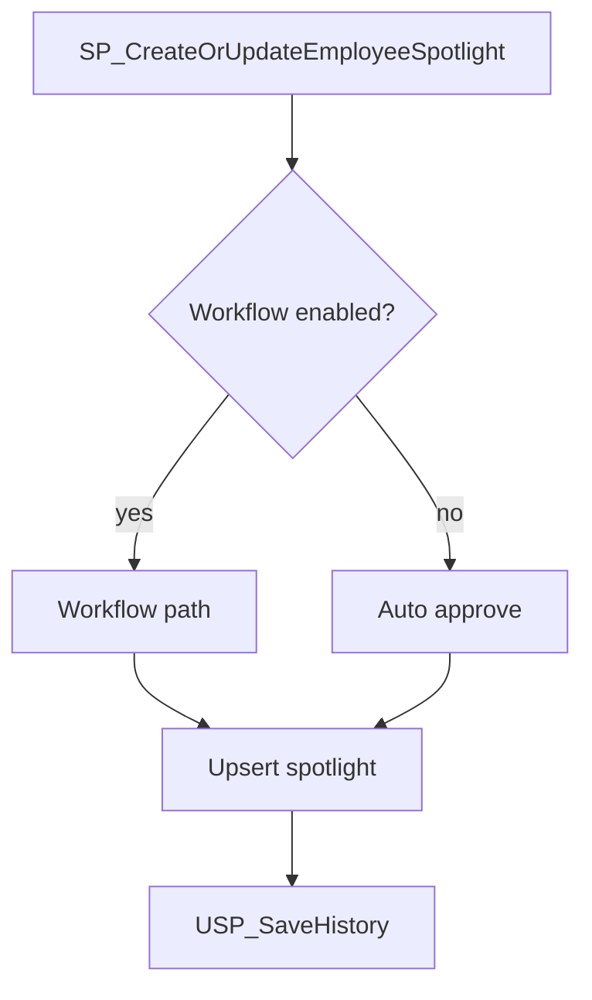

# SP_CreateOrUpdateEmployeeSpotlight

## What it does

Creates or updates an employee Spotlight (`TEmployeeSpotlights`). Honours `TRnR_WorkflowConfiguration` for `SpotlightAward` (pending + workflow vs auto-approve). Returns new id via `@NewId`. Snapshots with `USP_SaveHistory`.

## Parameters

| Name | Direction | What it is for |
|---|---|---|
| `@SpotlightId` | in | Existing id for update; null/0 inserts |
| `@EmployerId` | in | Employer scope |
| `@UserId` | in | User context |
| `@SpotlightTitle` / `@SpotlightStory` | in | Content |
| `@KeyAchievements` / `@AttachedDocuments` | in | Optional JSON/text |
| `@ActiveFrom` / `@ActiveTo` | in | Active window |
| `@CreatedByUserId` | in | Acting user |
| `@NewId` | out | Inserted/updated id |

## Call sequence

## Callers

No other procedure executes this object. App callers: Rewards_and_Recognition admin spotlight-award API → [Admin Console](/docs/guides/reward-and-recognition/admin-console).

## Nested

| Object | Kind | When |
|---|---|---|
| `SP_CM_GetWorkflowTreeXmlDetailsByPageTitle` | procedure | workflow on |
| `SP_CM_GetDataforRequestWorkFlows` | procedure | workflow on |
| `SP_CM_GetDataForEmailNotification` | procedure | workflow on |
| `FN_CM_GetMgrFromRequestWorkflows` / `FN_GetEmployeeName_Multi` / `FN_CM_GetApproverList` | function | workflow on |
| `USP_SaveHistory` | procedure (synonym) | after save |

## Steps

1. Script is `HRMS-DATABASE/HRMS-RewardNRecognition/STORED_PROCEDURE/SP_CreateOrUpdateEmployeeSpotlight.sql`.
2. Read workflow toggle for `SpotlightAward`.
3. When enabled, load workflow tree and approver rows.
4. Insert or update `TEmployeeSpotlights`; set `@NewId`.
5. When workflow on, write request workflows and notifications.
6. Call `USP_SaveHistory`.

## Tables

| Table | Read or write |
|---|---|
| `dbo.TRnR_WorkflowConfiguration` | read |
| `dbo.TEmployeeSpotlights` | read/write |
| `dbo.TRequestWorkflows` | write when workflow on |
| `dbo.TEmailNotification` | write when workflow on |

## Unresolved calls

`USP_SaveHistory` synonym target body not in RewardNRecognition tree.

## Flow

