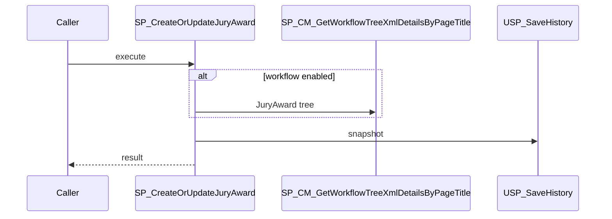
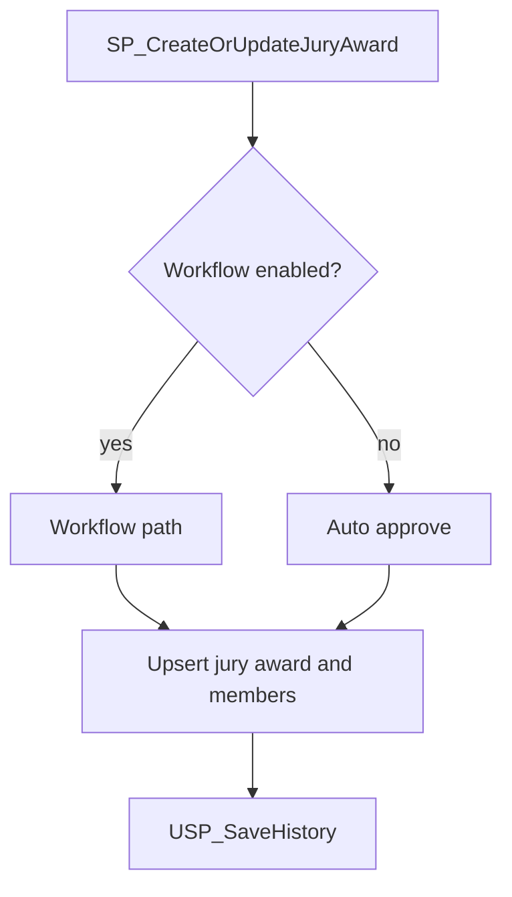

# SP_CreateOrUpdateJuryAward

## What it does

Creates or updates a jury award (`TJuryAwards`) including jury members, eligibility JSON, reward options, and optional certificate template. Honours `TRnR_WorkflowConfiguration` for `JuryAward`. May write certificate snapshot rows and history via `USP_SaveHistory`.

## Parameters

| Name | Direction | What it is for |
|---|---|---|
| `@JuryAwardId` | in | Existing id for update; null/0 inserts |
| `@EmployerId` | in | Employer scope |
| `@AwardName` / `@Description` | in | Award identity |
| `@NominationStartDate` / `@NominationEndDate` | in | Nomination window |
| `@ResultStartDate` / `@ResultEndDate` | in | Optional result window |
| `@RewardOptionIds` / `@AwardRewardOptionId` / `@RewardValue` | in | Rewards |
| `@Eligible*` JSON params | in | Eligibility filters |
| `@JuryMembersJson` | in | Jury members payload |
| `@CreatedByUserId` | in | Acting user |
| `@CertificateTemplateId` | in | Optional certificate template |

## Call sequence

## Callers

No other procedure executes this object. App callers: Rewards_and_Recognition admin jury-awards API → [Admin Console](/docs/guides/reward-and-recognition/admin-console).

## Nested

| Object | Kind | When |
|---|---|---|
| `SP_CM_GetWorkflowTreeXmlDetailsByPageTitle` | procedure | workflow on |
| `SP_CM_GetDataforRequestWorkFlows` | procedure | workflow on |
| `SP_CM_GetDataForEmailNotification` | procedure | workflow on |
| `FN_CM_GetMgrFromRequestWorkflows` / `FN_GetEmployeeName_Multi` / `FN_CM_GetApproverList` | function | workflow on |
| `USP_SaveHistory` | procedure (synonym) | after save |

## Steps

1. Script is `HRMS-DATABASE/HRMS-RewardNRecognition/STORED_PROCEDURE/SP_CreateOrUpdateJuryAward.sql`.
2. Validate award fields and jury members JSON; read `JuryAward` workflow toggle.
3. When workflow on, resolve workflow and approvers.
4. Insert/update `TJuryAwards` and related jury member / eligibility / certificate snapshot rows.
5. When workflow on, write `TRequestWorkflows` and notifications.
6. Snapshot with `USP_SaveHistory`.

## Tables

| Table | Read or write |
|---|---|
| `dbo.TRnR_WorkflowConfiguration` | read |
| `dbo.TJuryAwards` | read/write |
| `dbo.TJuryMembers` | read/write |
| `dbo.TRequestWorkflows` | write when workflow on |
| `dbo.TEmailNotification` | write when workflow on |

## Unresolved calls

`USP_SaveHistory` synonym target body not in RewardNRecognition tree.

## Flow

