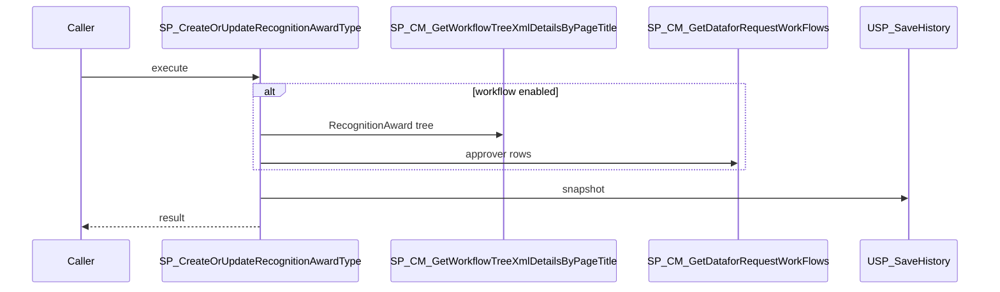
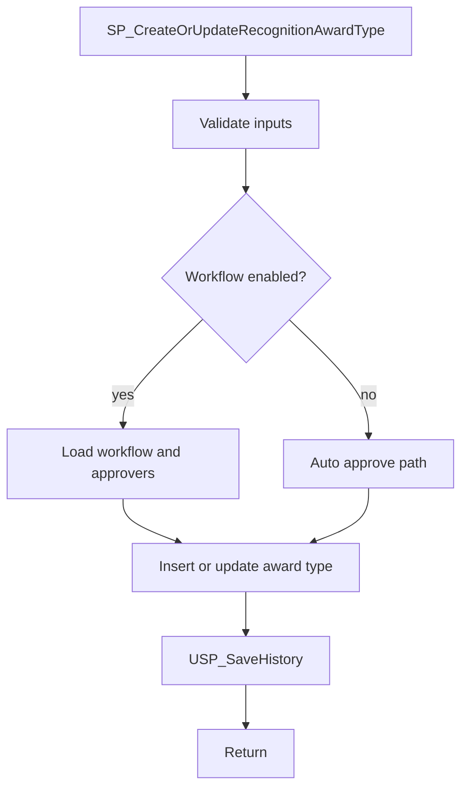

# SP_CreateOrUpdateRecognitionAwardType

## What it does

Creates or updates a recognition award type for an employer (`TRecognitionAwardTypesMaster`). Validates point type rules, giver roles, optional certificate template, and core-values JSON. Reads `TRnR_WorkflowConfiguration` for `RecognitionAward`: when workflow is on, the type is saved as `pending_approval` with `TRequestWorkflows` / email / home-page notification side effects; when off, it is auto-approved. Snapshots history via `USP_SaveHistory`.

## Parameters

| Name | Direction | What it is for |
|---|---|---|
| `@EmployerId` | in | Employer scope |
| `@Id` | in | Existing award type id for update; null/0 inserts |
| `@Code` | in | Unique code within employer |
| `@DisplayName` | in | Display name |
| `@Description` | in | Optional description |
| `@IconName` | in | Optional icon |
| `@PointType` | in | `Fixed Points` / `Variable Points` / `No Points` |
| `@PointsIsVariable` | in | Variable flag |
| `@PointsMin` / `@PointsMax` / `@PointsValue` | in | Point bounds / fixed value |
| `@Visibility` | in | Visibility |
| `@AwardCanBeGivenBy` | in | Comma-separated giver role ids |
| `@RewardOptionIds` | in | Optional reward option ids JSON/list |
| `@CertificateTemplateId` | in | Optional active custom certificate template |
| `@CreatedByUserId` | in | Acting user (required) |
| `@CoreValues` | in | Optional JSON array |
| `@EnableRecognitionTitle` | in | Title field toggle |

## Call sequence

## Callers

No other procedure executes this object. App callers: Rewards_and_Recognition admin recognition-award API → [Admin Console](/docs/guides/reward-and-recognition/admin-console).

## Nested

| Object | Kind | When |
|---|---|---|
| `SP_CM_GetWorkflowTreeXmlDetailsByPageTitle` | procedure | workflow on |
| `SP_CM_GetDataforRequestWorkFlows` | procedure | workflow on |
| `SP_CM_GetDataForEmailNotification` | procedure | workflow on after insert |
| `FN_CM_GetMgrFromRequestWorkflows` | function | workflow on |
| `FN_GetEmployeeName_Multi` | function | workflow on |
| `FN_CM_GetApproverList` | function | workflow on |
| `USP_SaveHistory` | procedure (synonym) | after save |

## Steps

1. Script is `HRMS-DATABASE/HRMS-RewardNRecognition/STORED_PROCEDURE/SP_CreateOrUpdateRecognitionAwardType.sql`.
2. Validate employer, code, display name, user, point-type rules, giver roles, certificate template, core-values JSON.
3. Read `IsWorkflowEnabled` for `RecognitionAward`.
4. When enabled, resolve workflow tree and approver temp rows; throw if missing.
5. Insert or update `TRecognitionAwardTypesMaster` (pending or approved).
6. When workflow on, write `TRequestWorkflows`, status history, email notification, and pending custom status.
7. Call `USP_SaveHistory` for the award-type row.

## Tables

| Table | Read or write |
|---|---|
| `dbo.TRnR_WorkflowConfiguration` | read |
| `dbo.TCertificateCustomTemplates` | read |
| `dbo.TRnR_AwardGiverRoleMaster` | read |
| `dbo.TRecognitionAwardTypesMaster` | read/write |
| `dbo.TRequestWorkflows` | write when workflow on |
| `dbo.TEmailNotification` | write when workflow on |

## Unresolved calls

`USP_SaveHistory` resolves via synonym to HRMS; procedure body is not in the RewardNRecognition Liquibase tree.

## Flow

