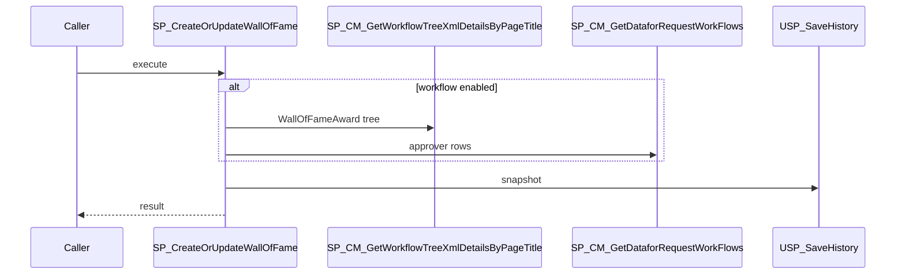
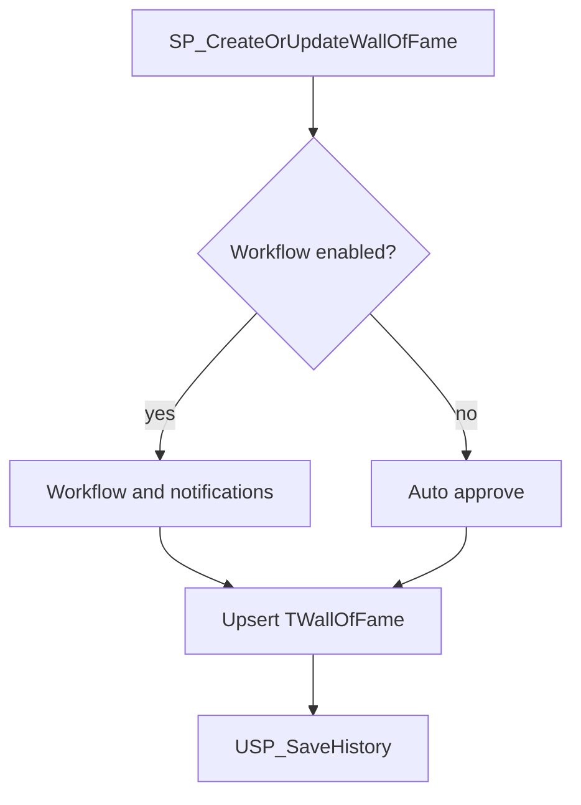

# SP_CreateOrUpdateWallOfFame

## What it does

Creates or updates a Wall of Fame entry (`TWallOfFame`) for an employer. Reads `TRnR_WorkflowConfiguration` for `WallOfFameAward`: when enabled, the entry is pending approval with request-workflow / email side effects; when disabled, it is auto-approved. Writes history via `USP_SaveHistory`.

## Parameters

| Name | Direction | What it is for |
|---|---|---|
| `@WallOfFameId` | in | Existing id for update; null/0 inserts |
| `@EmployerId` | in | Employer scope |
| `@UserId` | in | User context |
| `@WallOfFameTitle` | in | Title |
| `@WallOfFameStory` | in | Optional story |
| `@ActiveFrom` / `@ActiveTo` | in | Active window |
| `@CreatedByUserId` | in | Acting user |

## Call sequence

## Callers

No other procedure executes this object. App callers: Rewards_and_Recognition admin wall-of-fame API → [Admin Console](/docs/guides/reward-and-recognition/admin-console).

## Nested

| Object | Kind | When |
|---|---|---|
| `SP_CM_GetWorkflowTreeXmlDetailsByPageTitle` | procedure | workflow on |
| `SP_CM_GetDataforRequestWorkFlows` | procedure | workflow on |
| `SP_CM_GetDataForEmailNotification` | procedure | workflow on |
| `FN_CM_GetMgrFromRequestWorkflows` | function | workflow on |
| `FN_GetEmployeeName_Multi` | function | workflow on |
| `USP_SaveHistory` | procedure (synonym) | after save |

## Steps

1. Script is `HRMS-DATABASE/HRMS-RewardNRecognition/STORED_PROCEDURE/SP_CreateOrUpdateWallOfFame.sql`.
2. Validate employer/user and active dates; read workflow toggle for `WallOfFameAward`.
3. When workflow on, resolve workflow tree and approvers.
4. Insert or update `TWallOfFame` as pending or approved.
5. When workflow on, write `TRequestWorkflows` and email notification rows.
6. Snapshot with `USP_SaveHistory`.

## Tables

| Table | Read or write |
|---|---|
| `dbo.TRnR_WorkflowConfiguration` | read |
| `dbo.TWallOfFame` | read/write |
| `dbo.TRequestWorkflows` | write when workflow on |
| `dbo.TEmailNotification` | write when workflow on |

## Unresolved calls

`USP_SaveHistory` body not present in RewardNRecognition Liquibase (synonym to HRMS).

## Flow

