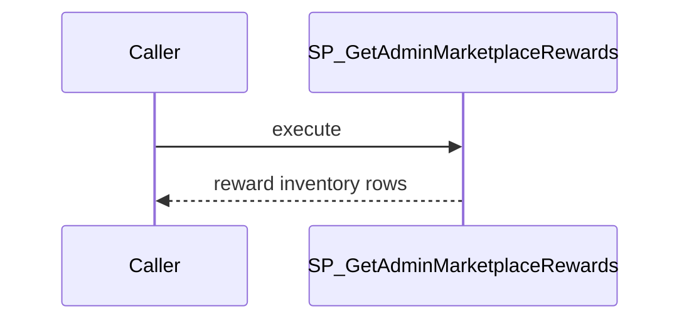
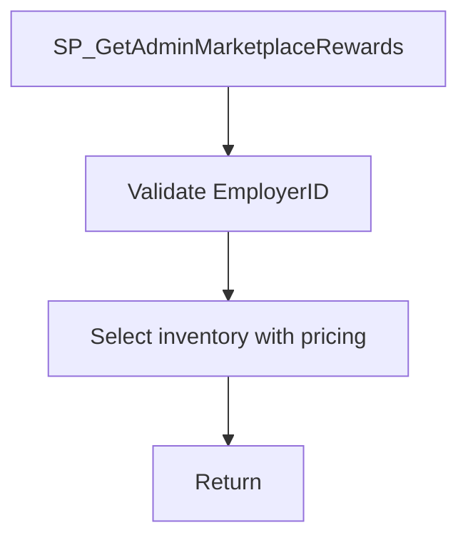

# SP_GetAdminMarketplaceRewards

## What it does

Returns admin Marketplace reward inventory for an employer from `TRedemptionOption` joined to category and approved finance rate. Masks voucher codes, prices gift-card categories from `Value * pointToCurrencyRate`, and optionally filters by category / active / redeemed.

## Parameters

| Name | Direction | What it is for |
|---|---|---|
| `@EmployerID` | in | Employer scope (must be > 0) |
| `@CategoryId` | in | Optional category filter |
| `@IsActive` | in | Optional active filter |
| `@IsRedeemed` | in | Optional redeemed filter |

## Call sequence

## Callers

No other procedure executes this object. App callers: Rewards_and_Recognition `GET /api/v1/marketplace/admin/rewards` → [Admin Console](/docs/guides/reward-and-recognition/admin-console).

## Nested

Calls no other procedures or functions.

## Steps

1. Script is `HRMS-DATABASE/HRMS-RewardNRecognition/STORED_PROCEDURE/SP_GetAdminMarketplaceRewards.sql`.
2. Reject invalid employer.
3. Select options with category name, computed points, masked voucher, and redemption activity points when redeemed.
4. Apply optional filters; order by title / value / created.

## Tables

| Table | Read or write |
|---|---|
| `dbo.TRedemptionOption` | read |
| `dbo.TRedemptionCategory` | read |
| `dbo.TFinanceConfiguration` | read |
| `dbo.TEmployeeRedemptionActivity` | read |

## Unresolved calls

None.

## Flow

