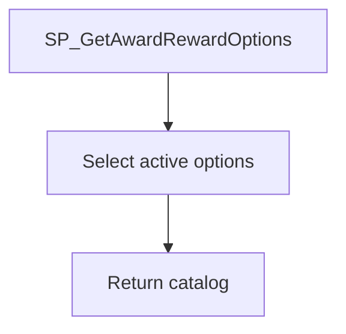

# SP_GetAwardRewardOptions

## What it does

Read-only catalog of active award reward options. Returns every `TAwardRewardOptions` row with `deleted_at IS NULL`, ordered by `id`, including code, display name, description, disabled flag, monetary flag, and extra-PTO flag. No parameters; does not write tables or call other procedures.

## Parameters

None.

## Call sequence

Calls no other procedures or functions.

## Callers

No other procedure or function in `HRMS-RewardNRecognition/STORED_PROCEDURE` executes this object. App callers live in the Rewards_and_Recognition backend that is not in this SourceCode checkout.

| Object | Kind | Page |
|---|---|---|
| Give Recognition React / RnR API | app | [Give Recognition](/docs/guides/reward-and-recognition/give-recognition) (host only; API not in checkout) |

## Nested

Calls no other procedures or functions.

## Steps

In `HRMS-DATABASE/HRMS-RewardNRecognition/STORED_PROCEDURE/SP_GetAwardRewardOptions.sql`:

1. `SET NOCOUNT ON`.
2. Select active reward-option columns from `TAwardRewardOptions` where `deleted_at IS NULL`.
3. Order by `id`.

## Tables

| Table | Read or write |
|---|---|
| `dbo.TAwardRewardOptions` | read |

## Flow

