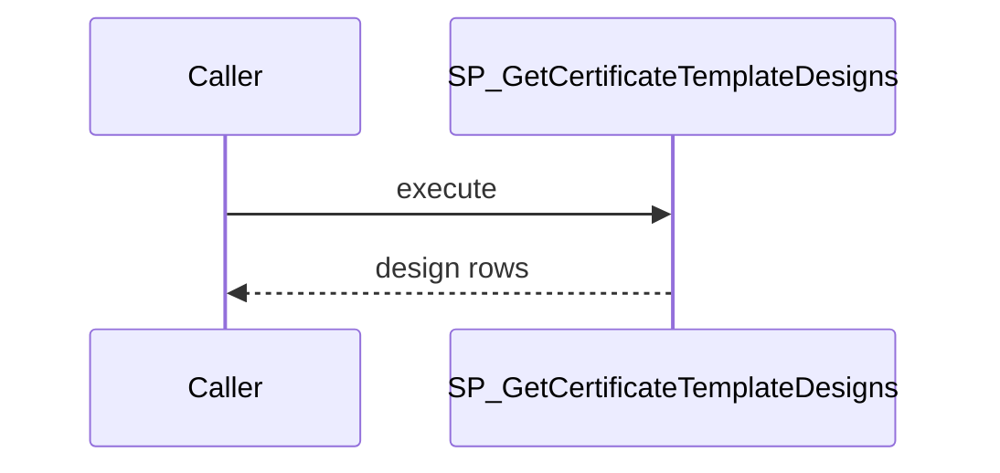
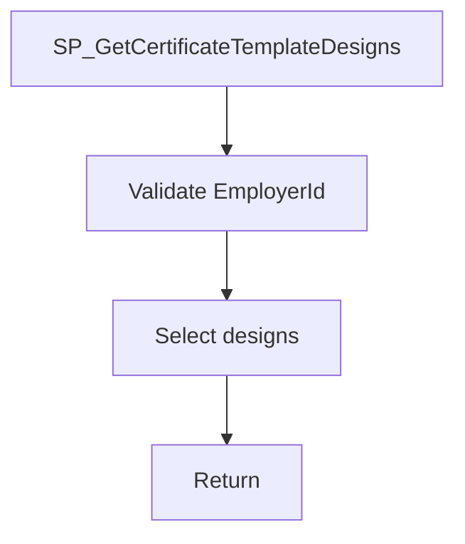

# SP_GetCertificateTemplateDesigns

## What it does

Lists non-deleted certificate custom template designs for an employer from `TCertificateCustomTemplates`, optionally filtered to active only, newest first.

## Parameters

| Name | Direction | What it is for |
|---|---|---|
| `@EmployerId` | in | Employer scope (must be > 0) |
| `@ActiveOnly` | in | When 1, only `is_active = 1` |

## Call sequence

## Callers

No other procedure executes this object. App callers: Rewards_and_Recognition `GET /api/v1/rewards/admin/certificate-template-designs` → [Admin Console](/docs/guides/reward-and-recognition/admin-console).

## Nested

Calls no other procedures or functions.

## Steps

1. Script is `HRMS-DATABASE/HRMS-RewardNRecognition/STORED_PROCEDURE/SP_GetCertificateTemplateDesigns.sql`.
2. Reject invalid employer.
3. Select designs where `deleted_at IS NULL`, optional active filter, order by `created_at` desc.

## Tables

| Table | Read or write |
|---|---|
| `dbo.TCertificateCustomTemplates` | read |

## Unresolved calls

None.

## Flow

