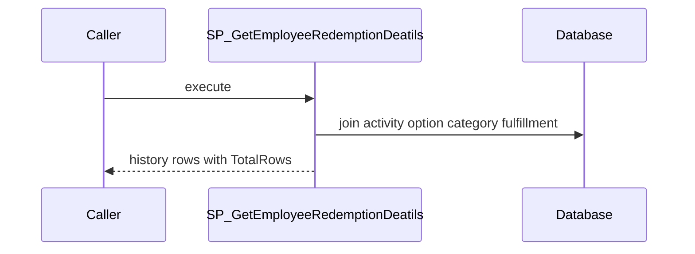
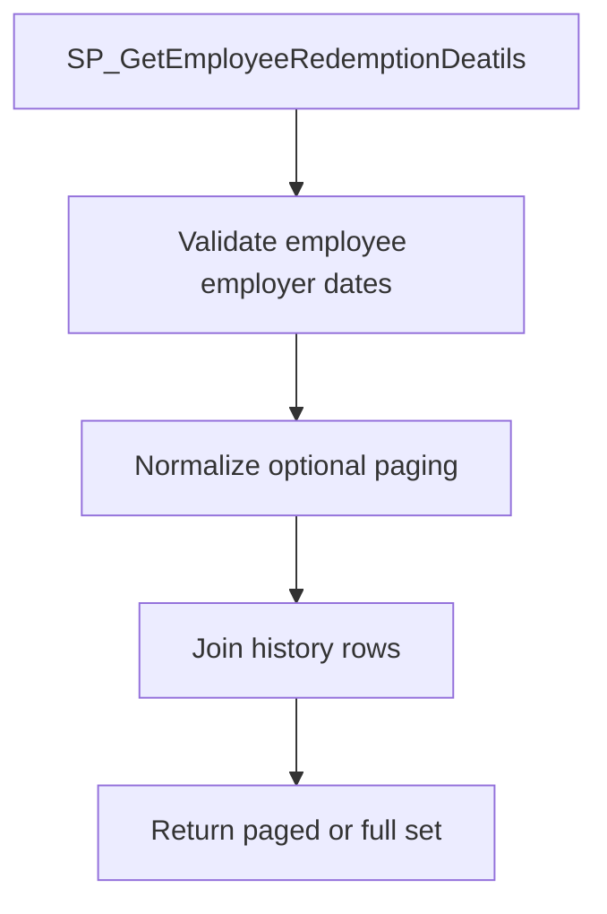

# SP_GetEmployeeRedemptionDeatils

## What it does

Returns one employee’s Marketplace redemption history for an employer (procedure name spelling `Deatils` as inventoried). Joins activity to option, category, and optional `TRedemptionFulfillment`, optionally filters by created-at range, and optionally pages (default page size 20, max 100). When paging params are omitted, returns all matching rows. Includes `TotalRows` via window count. Throws on invalid employee/employer or inverted date range.

## Parameters

| Name | Direction | What it is for |
|---|---|---|
| `@EmployeeID` | in | Redeeming employee. Must be greater than 0 |
| `@EmployerID` | in | Employer scope. Must be greater than 0 |
| `@PageNumber` | in | Optional 1-based page. Null with null page size disables paging |
| `@PageSize` | in | Optional page size. Default 20 when paging; capped at 100 |
| `@StartDate` | in | Optional inclusive `CreatedAt` lower bound |
| `@EndDate` | in | Optional inclusive `CreatedAt` upper bound |

## Call sequence

## Callers

No other procedure or function in `HRMS-RewardNRecognition/STORED_PROCEDURE` executes this object. App callers live in the Rewards_and_Recognition backend that is not in this SourceCode checkout. Admin fulfillment reports also list this SP in `TDataCatalog` for related tables.

| Object | Kind | Page |
|---|---|---|
| Marketplace React / RnR API | app | [Marketplace](/docs/guides/reward-and-recognition/marketplace) (host only; API not in checkout) |

## Nested

None.

## Steps

In `HRMS-DATABASE/HRMS-RewardNRecognition/STORED_PROCEDURE/SP_GetEmployeeRedemptionDeatils.sql`:

1. Reject invalid employee/employer; reject start after end when both dates are set.
2. Decide whether paging applies; normalize page number/size (default 20, max 100).
3. Select activity rows joined to option (same employer), category, and left-joined fulfillment, with optional date filters.
4. Order by `CreatedAt` / activity id descending; apply `OFFSET`/`FETCH` when paging is on (otherwise fetch all).

## Tables

| Table | Read or write |
|---|---|
| `dbo.TEmployeeRedemptionActivity` | read |
| `dbo.TRedemptionOption` | read |
| `dbo.TRedemptionCategory` | read |
| `dbo.TRedemptionFulfillment` | read |

## Flow

