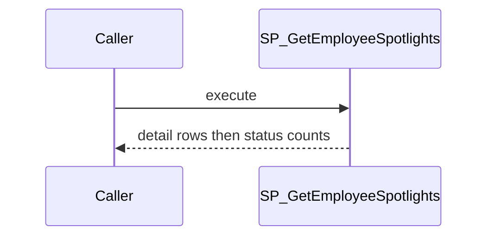
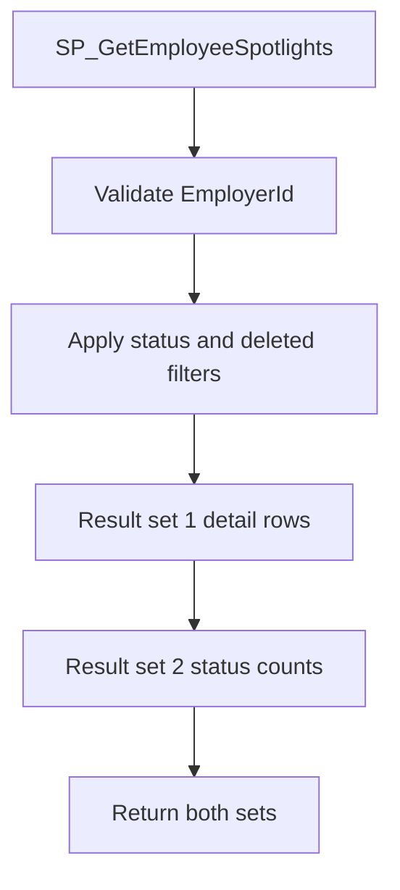

# SP_GetEmployeeSpotlights

## What it does

Returns Employee Spotlight rows for an employer as two result sets: (1) detail rows filtered by optional status, newest first; (2) per-status counts for the whole employer (ignores the status filter). Soft-deleted rows are excluded unless `@Status = 'disabled'`. Invalid employer id throws.

## Parameters

| Name | Direction | What it is for |
|---|---|---|
| `@EmployerId` | in | Employer scope. Must be greater than 0 |
| `@Status` | in | Optional status filter (for example `active`). `disabled` includes deleted rows |

## Call sequence

## Callers

No other procedure or function executes this object. App callers: `serviceGetEmployeeSpotlights` / active-list cache → `GET /rewards/admin/spotlight-award` from [Recognition Dashboard](/docs/guides/reward-and-recognition/recognition-dashboard).

## Nested

Calls no other procedures or functions.

## Steps

1. Script is `HRMS-DATABASE/HRMS-RewardNRecognition/STORED_PROCEDURE/SP_GetEmployeeSpotlights.sql`.
2. Reject null or non-positive `@EmployerId`.
3. When `@Status = 'disabled'`, include soft-deleted rows; otherwise require `deleted_at IS NULL`.
4. Select spotlight columns from `TEmployeeSpotlights` with optional status filter, order by `created_at` descending.
5. Second select aggregates status counts for the employer.

## Tables

| Table | Read or write |
|---|---|
| `dbo.TEmployeeSpotlights` | read |

## Unresolved calls

None.

## Flow

