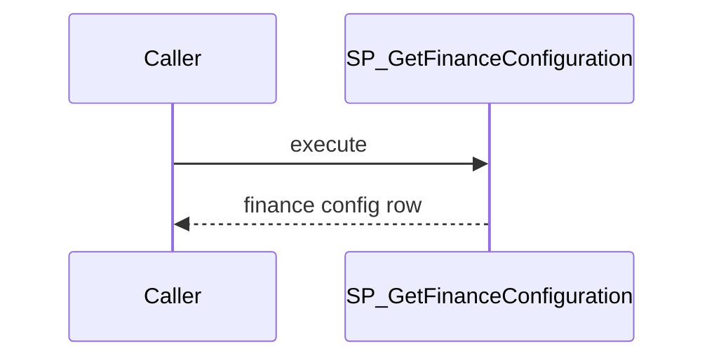
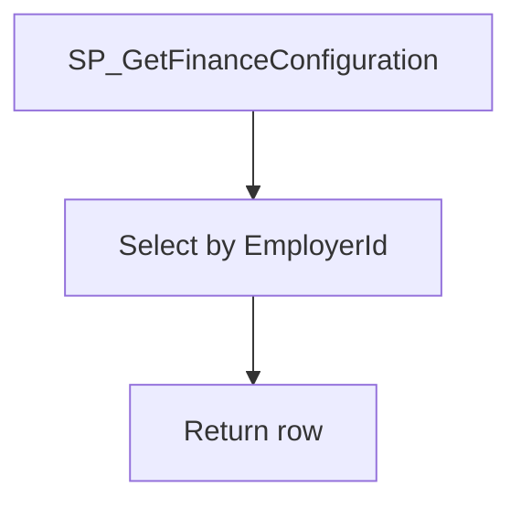

# SP_GetFinanceConfiguration

## What it does

Returns the live finance configuration row for an employer from `TFinanceConfiguration` (currency, point-to-currency rate, expiry days, min/max points, status).

## Parameters

| Name | Direction | What it is for |
|---|---|---|
| `@EmployerId` | in | Employer scope |

## Call sequence

## Callers

No other procedure executes this object. App callers: Rewards_and_Recognition `GET /api/v1/admin/finance/config` → [Admin Console](/docs/guides/reward-and-recognition/admin-console).

## Nested

Calls no other procedures or functions.

## Steps

1. Script is `HRMS-DATABASE/HRMS-RewardNRecognition/STORED_PROCEDURE/SP_GetFinanceConfiguration.sql`.
2. Select finance columns from `TFinanceConfiguration` for `@EmployerId`.
3. Rethrow on error.

## Tables

| Table | Read or write |
|---|---|
| `dbo.TFinanceConfiguration` | read |

## Unresolved calls

None.

## Flow

