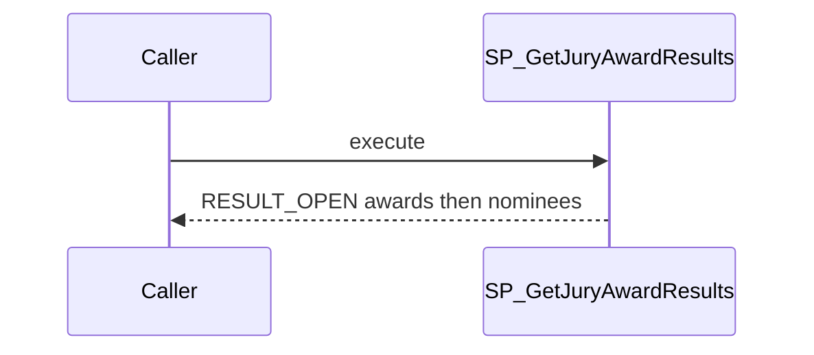
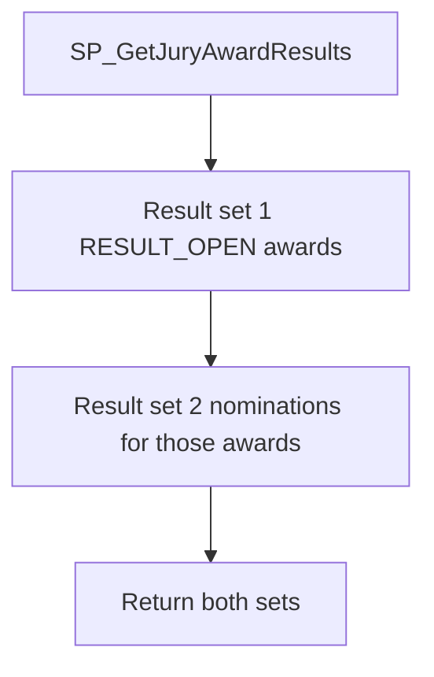

# SP_GetJuryAwardResults

## What it does

Returns jury award results for an employer as two result sets limited to awards with status `RESULT_OPEN` and `deleted_at IS NULL`: (1) award header rows (name, dates, tie/winner metadata, reward value/options/currency); (2) nominee rows for those awards (nomination count, winner flag, final score), ordered by award then winner then nomination count.

## Parameters

| Name | Direction | What it is for |
|---|---|---|
| `@EmployerId` | in | Employer scope |

## Call sequence

## Callers

No other procedure or function executes this object. App callers: `serviceGetJuryAwardResults` → `GET /rewards/admin/jury-awards/results` from [Recognition Dashboard](/docs/guides/reward-and-recognition/recognition-dashboard).

## Nested

Calls no other procedures or functions.

## Steps

1. Script is `HRMS-DATABASE/HRMS-RewardNRecognition/STORED_PROCEDURE/SP_GetJuryAwardResults.sql`.
2. Select from `TJuryAwards` where employer matches, not deleted, status `RESULT_OPEN`, order by `winner_announced_at` descending.
3. Select from `TJuryNominations` joined to those awards for nominee rows, order by award, winner, nomination count.

## Tables

| Table | Read or write |
|---|---|
| `dbo.TJuryAwards` | read |
| `dbo.TJuryNominations` | read |

## Unresolved calls

None.

## Flow

