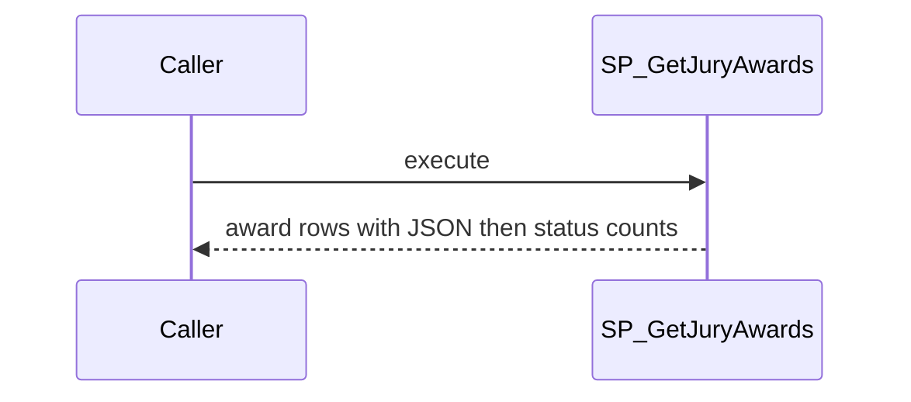
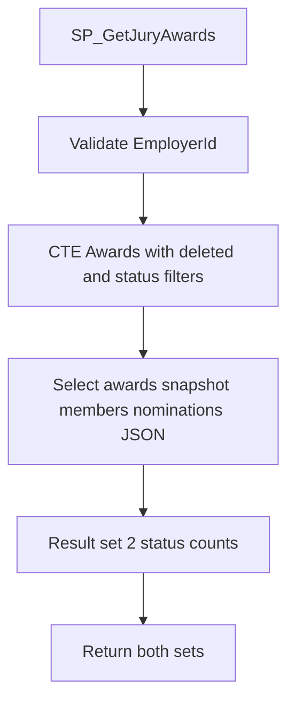

# SP_GetJuryAwards

## What it does

Returns jury awards for an employer as two result sets: (1) award rows with eligibility JSON columns, certificate design snapshot, jury members JSON, and nested nominations JSON (including nomination details and nominee name/email from `TEmployee`); (2) per-status counts for the employer. Soft-deleted awards are excluded unless `@Status = 'disabled'`. Optional `@Status` filters the award list. Invalid employer id throws.

## Parameters

| Name | Direction | What it is for |
|---|---|---|
| `@EmployerId` | in | Employer scope. Must be greater than 0 |
| `@Status` | in | Optional award status filter (for example `nomination_open`). `disabled` returns soft-deleted rows |

## Call sequence

## Callers

No other procedure or function executes this object. App callers: `serviceGetJuryAwards` → `GET /rewards/admin/jury-awards` from [Recognition Dashboard](/docs/guides/reward-and-recognition/recognition-dashboard) (status `nomination_open` on this leaf).

## Nested

Calls no other procedures or functions. Subqueries read related tables via FOR JSON PATH.

## Steps

1. Script is `HRMS-DATABASE/HRMS-RewardNRecognition/STORED_PROCEDURE/SP_GetJuryAwards.sql`.
2. Reject null or non-positive `@EmployerId`.
3. CTE `Awards` filters `TJuryAwards` by employer, deleted_at rules, and optional status.
4. Select award columns, left join `TJuryAwardCertificateSnapshot`, embed jury members and nominations as JSON (noms join `TEmployee` for name/email).
5. Second select aggregates status counts for the employer.

## Tables

| Table | Read or write |
|---|---|
| `dbo.TJuryAwards` | read |
| `dbo.TJuryAwardCertificateSnapshot` | read |
| `dbo.TJuryMembers` | read |
| `dbo.TJuryNominations` | read |
| `dbo.TJuryNominationDetails` | read |
| `dbo.TEmployee` | read (synonym → HRMS) |

## Unresolved calls

None.

## Flow

