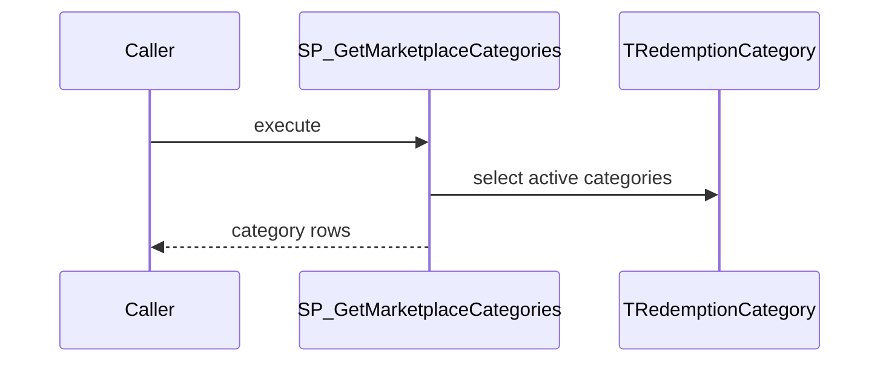
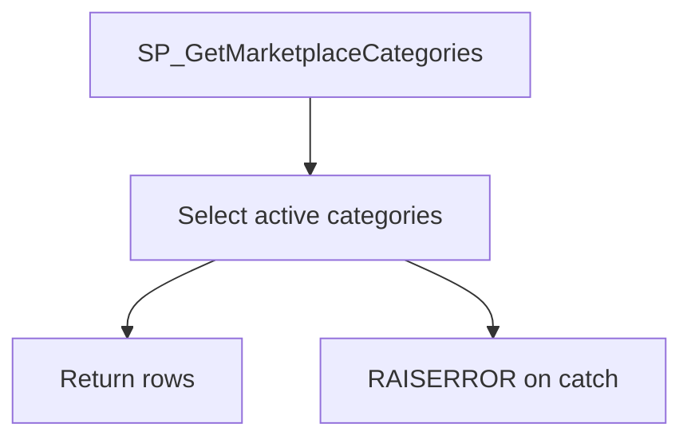

# SP_GetMarketplaceCategories

## What it does

Returns every active `TRedemptionCategory` row ordered by category name, including flags for voucher requirement, fulfillment tracking, and whether the category is monetary. Used by the employee Marketplace filter list. Errors re-raise with the original severity and state.

## Parameters

None.

## Call sequence

## Callers

No other procedure or function in `HRMS-RewardNRecognition/STORED_PROCEDURE` executes this object. App callers live in the Rewards_and_Recognition backend that is not in this SourceCode checkout.

| Object | Kind | Page |
|---|---|---|
| Marketplace React / RnR API | app | [Marketplace](/docs/guides/reward-and-recognition/marketplace) (host only; API not in checkout) |

## Nested

None.

## Steps

In `HRMS-DATABASE/HRMS-RewardNRecognition/STORED_PROCEDURE/SP_GetMarketplaceCategories.sql`:

1. Select `RedemptionCategoryID`, `CategoryName`, `RequiresVoucherCode`, `RequiresFulfillmentTracking`, and `IsMonetary` from `TRedemptionCategory` where `IsActive = 1`.
2. Order by `CategoryName`.
3. On error, capture message/severity/state and `RAISERROR` them.

## Tables

| Table | Read or write |
|---|---|
| `dbo.TRedemptionCategory` | read |

## Flow

