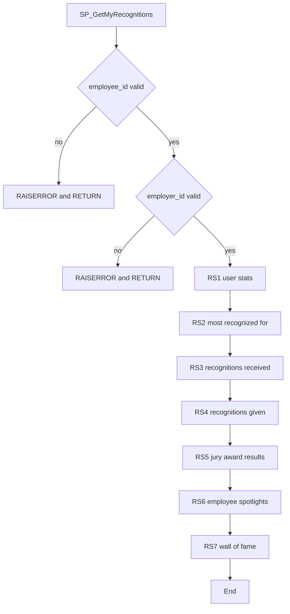

# SP_GetMyRecognitions

## What it does

Read-only portfolio for one employee at one employer. After validating `@employee_id` and `@employer_id`, it returns seven result sets in fixed order: user stats, most-recognized award type, approved recognitions received (with certificate metadata), recognitions given, jury award results, Employee Spotlight rows, and Wall of Fame rows. Optional `@start_date` / `@end_date` filter each set. It does not write tables or call other procedures.

## Parameters

| Name | Direction | What it is for |
|---|---|---|
| `@employee_id` | in | Employee whose portfolio is returned (required, non-zero) |
| `@employer_id` | in | Employer scope (required, non-zero) |
| `@start_date` | in | Optional lower bound on created/announced/active dates |
| `@end_date` | in | Optional upper bound on created/announced/active dates |

## Call sequence

Calls no other procedures or functions.

## Callers

No other procedure or function in `HRMS-RewardNRecognition` calls this object. Application callers (RnR API `GET /api/v1/employee-recognitions/my-recognitions`) are outside this SQL tree.

## Nested

Calls no other procedures or functions.

## Steps

1. `SET NOCOUNT ON` and enter `TRY` (`SP_GetMyRecognitions.sql`).
2. Raise and return if `@employee_id` is null or zero.
3. Raise and return if `@employer_id` is null or zero.
4. Result set 1 — user stats from `TEmployeeRecognition`: approved received count, approved given count, sum of points received, company rank by points, expired points, redeemed points (date filters when provided).
5. Result set 2 — top award type for received approved recognitions (`TEmployeeRecognition` join `TRecognitionAwardTypesMaster`).
6. Result set 3 — recognitions received (`status = 'approved'`, `is_active = 1`) with award, certificate template, and certificate snapshot columns.
7. Result set 4 — recognitions given (`is_active = 1`) with award columns (includes non-approved statuses).
8. Result set 5 — jury award results for the employee joined to `TJuryAwards` and certificate tables (`deleted_at IS NULL`).
9. Result set 6 — `TEmployeeSpotlights` for `user_id` / `employer_id` with status in approved/active/ended/completed.
10. Result set 7 — `TWallOfFame` for the same user/employer and status filter.
11. On error, re-raise with severity and state from `CATCH`.

## Tables

| Table | Read or write |
|---|---|
| `dbo.TEmployeeRecognition` | read |
| `dbo.TRecognitionAwardTypesMaster` | read |
| `dbo.TCertificateCustomTemplates` | read |
| `dbo.TEmployeeRecognitionCertificateSnapshot` | read |
| `dbo.TJuryAwardResults` | read |
| `dbo.TJuryAwards` | read |
| `dbo.TJuryAwardCertificateSnapshot` | read |
| `dbo.TEmployeeSpotlights` | read |
| `dbo.TWallOfFame` | read |

## Flow

