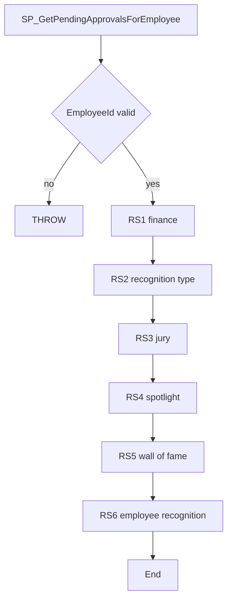

# SP_GetPendingApprovalsForEmployee

## What it does

Read-only inbox for one employee acting as workflow manager. After validating `@EmployeeId`, it returns **six** result sets of pending RnR requests where `TRequestWorkflows.ManagerId` matches, `ApproveStatus = 'P'`, and `IsDeleted = 0`, joined to the request artifact. Order is fixed: finance configuration, recognition award types, jury awards, employee spotlights, wall of fame, employee recognitions. It does not write tables or call other procedures.

## Parameters

| Name | Direction | What it is for |
|---|---|---|
| `@EmployeeId` | in | Approver employee id (required, greater than 0) |

## Call sequence

Calls no other procedures or functions (uses `STRING_AGG` / `STRING_SPLIT` and inline scalar `FN` display helpers only via joins to master data).

## Callers

No other procedure or function in `HRMS-RewardNRecognition/STORED_PROCEDURE` executes this object. App callers live in the Rewards_and_Recognition backend that is not in this SourceCode checkout. `TDataCatalog` lists this procedure among consumers of the Notifications-labelled RnR tables.

| Object | Kind | Page |
|---|---|---|
| Notifications React / RnR API | app | [Notifications](/docs/guides/reward-and-recognition/notifications) (host only; API not in checkout) |

## Nested

Calls no other procedures or functions.

## Steps

In `HRMS-DATABASE/HRMS-RewardNRecognition/STORED_PROCEDURE/SP_GetPendingApprovalsForEmployee.sql`:

1. `SET NOCOUNT ON` / `SET XACT_ABORT ON`; throw if `@EmployeeId` invalid.
2. Result set 1 — `RewardFinanceChange` pending rows join `TFinanceConfigurationRequest` (includes old/new config JSON).
3. Result set 2 — `RecognitionAward` pending rows join `TRecognitionAwardTypesMaster` (includes giver-role display names from `TRnR_AwardGiverRoleMaster`).
4. Result set 3 — `JuryAward` pending rows join `TJuryAwards` (includes jury member ids JSON from `TJuryMembers`).
5. Result set 4 — `SpotlightAward` pending rows join `TEmployeeSpotlights`.
6. Result set 5 — `WallOfFameAward` pending rows join `TWallOfFame`.
7. Result set 6 — `EmployeeRecognition` pending rows join `TEmployeeRecognition` (`is_active = 1`).
8. On error, re-raise with a prefixed message from `CATCH`.

## Tables

| Table | Read or write |
|---|---|
| `dbo.TRequestWorkflows` | read |
| `dbo.TFinanceConfigurationRequest` | read |
| `dbo.TFinanceConfiguration` | read |
| `dbo.TRecognitionAwardTypesMaster` | read |
| `dbo.TRnR_AwardGiverRoleMaster` | read |
| `dbo.TJuryAwards` | read |
| `dbo.TJuryMembers` | read |
| `dbo.TEmployeeSpotlights` | read |
| `dbo.TWallOfFame` | read |
| `dbo.TEmployeeRecognition` | read |

## Unresolved calls

None.

## Flow

