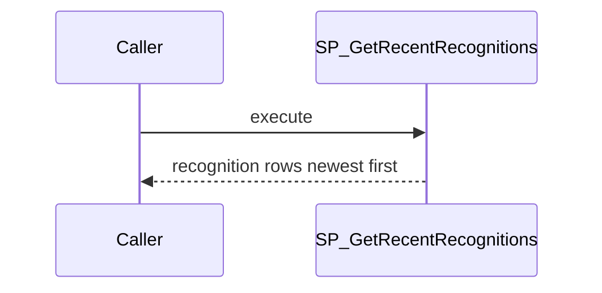
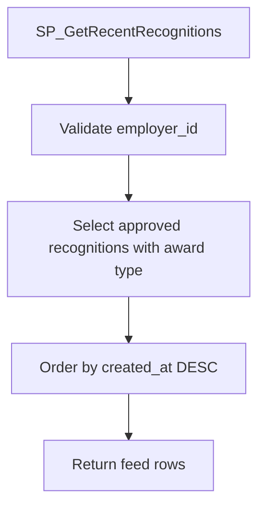

# SP_GetRecentRecognitions

## What it does

Lists approved, active employee recognitions for an employer (optional business unit, location, and created_at filters), newest first. Each row includes recipient/sender ids, points, title, message, currency, featured flag, BU/location snapshots, reward option and core-value JSON columns, plus award display name and icon from the award-type master. Invalid employer id throws. Errors return an `apiStatus = ERROR` row.

## Parameters

| Name | Direction | What it is for |
|---|---|---|
| `@employer_id` | in | Employer scope. Must be greater than 0 |
| `@business_unit_id` | in | Optional recipient BU filter. Default null = all |
| `@location_id` | in | Optional recipient location filter. Default null = all |
| `@start_date` | in | Optional inclusive created_at lower bound |
| `@end_date` | in | Optional inclusive created_at upper bound |

## Call sequence

## Callers

No other procedure or function executes this object. App callers: `serviceGetRecentRecognitions` → `GET /employee-recognitions/recent` from [Recognition Dashboard](/docs/guides/reward-and-recognition/recognition-dashboard).

## Nested

Calls no other procedures or functions.

## Steps

1. Script is `HRMS-DATABASE/HRMS-RewardNRecognition/STORED_PROCEDURE/SP_GetRecentRecognitions.sql`.
2. Reject null or non-positive `@employer_id`.
3. Select from `TEmployeeRecognition` left join `TRecognitionAwardTypesMaster` with NOLOCK.
4. Filter `is_active = 1`, `status = 'approved'`, and optional BU/location/date bounds.
5. Order by `created_at` descending.
6. On error, return ERROR metadata columns.

## Tables

| Table | Read or write |
|---|---|
| `dbo.TEmployeeRecognition` | read |
| `dbo.TRecognitionAwardTypesMaster` | read |

## Unresolved calls

None.

## Flow

