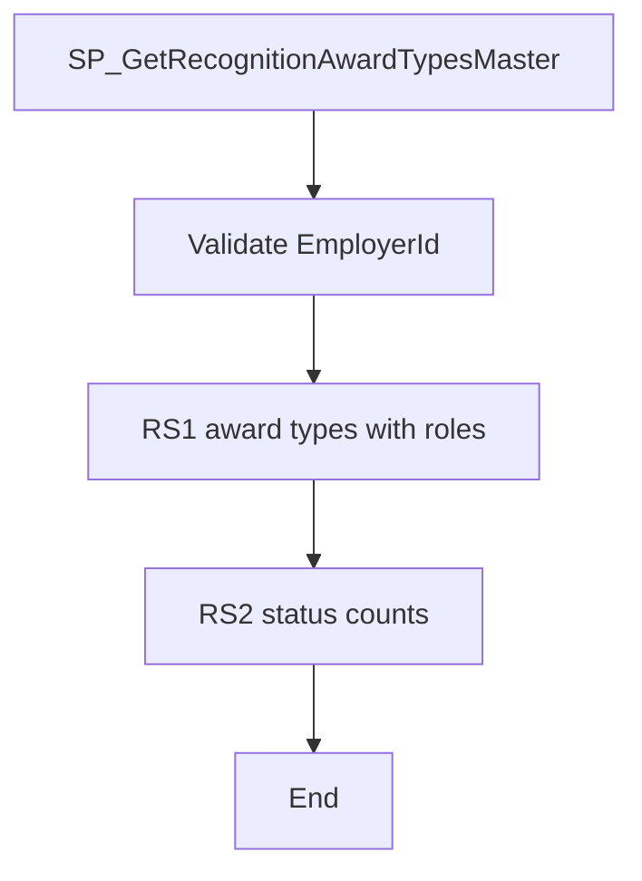

# SP_GetRecognitionAwardTypesMaster

## What it does

Read-only award-type catalog for one employer. Result set 1 returns recognition types from `TRecognitionAwardTypesMaster` (with certificate template name and aggregated giver-role names from `award_can_be_given_by`), filtered by optional `@Status` and soft-delete rules. Result set 2 returns status counts for the same employer (`pending_approval`, `approved`, `rejected`, `disabled`, `all`). It does not write tables or call other procedures.

## Parameters

| Name | Direction | What it is for |
|---|---|---|
| `@EmployerId` | in | Employer scope. Must be greater than 0 |
| `@Status` | in | Optional status filter. `disabled` selects soft-deleted rows; otherwise non-deleted rows, and when set also matches `r.status` |

## Call sequence

Calls no other procedures or functions.

## Callers

No other procedure or function in `HRMS-RewardNRecognition/STORED_PROCEDURE` executes this object. App callers live in the Rewards_and_Recognition backend that is not in this SourceCode checkout.

| Object | Kind | Page |
|---|---|---|
| Give Recognition React / RnR API | app | [Give Recognition](/docs/guides/reward-and-recognition/give-recognition) (host only; API not in checkout) |

## Nested

Calls no other procedures or functions.

## Steps

In `HRMS-DATABASE/HRMS-RewardNRecognition/STORED_PROCEDURE/SP_GetRecognitionAwardTypesMaster.sql`:

1. `SET NOCOUNT ON`, `SET XACT_ABORT ON`, enter `TRY`.
2. Throw if `@EmployerId` is null or not greater than 0 (`Employer Not found.`).
3. Result set 1 — select award-type columns for the employer; left join `TCertificateCustomTemplates` for template name; subquery `STRING_AGG` of active `TRnR_AwardGiverRoleMaster.RoleType` from CSV `award_can_be_given_by`.
4. Soft-delete filter: `@Status = 'disabled'` requires `deleted_at IS NOT NULL`; otherwise `deleted_at IS NULL`. When `@Status` is not null, also require `r.status = @Status`.
5. Order result set 1 by `created_at DESC`.
6. Result set 2 — count pending, approved, rejected, disabled, and all rows for the employer (disabled uses soft-deleted rows).
7. On error, re-throw with message and state from `CATCH`.

## Tables

| Table | Read or write |
|---|---|
| `dbo.TRecognitionAwardTypesMaster` | read |
| `dbo.TCertificateCustomTemplates` | read |
| `dbo.TRnR_AwardGiverRoleMaster` | read |

## Flow

