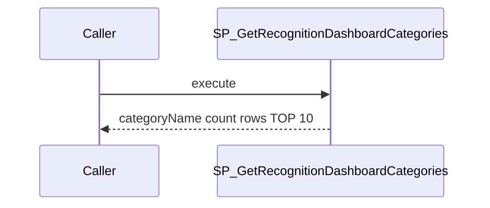
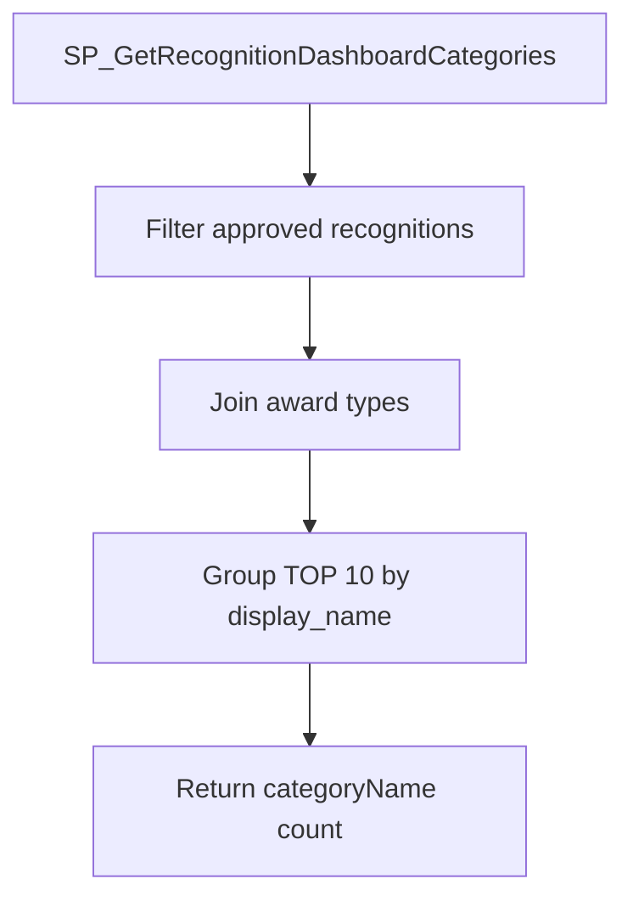

# SP_GetRecognitionDashboardCategories

## What it does

Returns the top 10 recognition award categories for an employer: each row is an award-type display name and the count of approved, active recognitions in the optional business unit, location, and created_at window. Ordered by count descending. Errors return an `apiStatus = ERROR` row.

## Parameters

| Name | Direction | What it is for |
|---|---|---|
| `@employer_id` | in | Employer scope |
| `@business_unit_id` | in | Optional recipient BU filter. Default null = all |
| `@location_id` | in | Optional recipient location filter. Default null = all |
| `@start_date` | in | Optional inclusive created_at lower bound |
| `@end_date` | in | Optional inclusive created_at upper bound |

## Call sequence

## Callers

No other procedure or function executes this object. App callers: `serviceGetRecognitionDashboardCategories` → `GET /employee-recognitions/dashboard/categories` from [Recognition Dashboard](/docs/guides/reward-and-recognition/recognition-dashboard).

## Nested

Calls no other procedures or functions.

## Steps

1. Script is `HRMS-DATABASE/HRMS-RewardNRecognition/STORED_PROCEDURE/SP_GetRecognitionDashboardCategories.sql`.
2. Join `TEmployeeRecognition` to `TRecognitionAwardTypesMaster` on `award_type_id`.
3. Filter employer, `is_active = 1`, `status = 'approved'`, and optional BU/location/date bounds.
4. Group by `display_name`, take top 10 by count descending.
5. On error, return ERROR metadata columns.

## Tables

| Table | Read or write |
|---|---|
| `dbo.TEmployeeRecognition` | read |
| `dbo.TRecognitionAwardTypesMaster` | read |

## Unresolved calls

None.

## Flow

