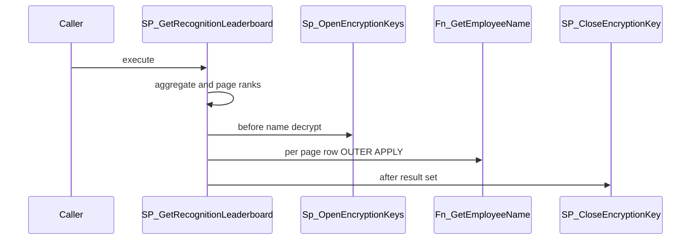
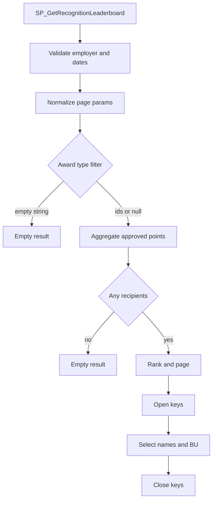

# SP_GetRecognitionLeaderboard

## What it does

Builds a paged recognition leaderboard for one employer. It sums approved, active `TEmployeeRecognition` points per recipient (optional business unit, location, date range, and award-type filters), ranks by total points then recognition count, and returns one page of rows with decrypted display names and business unit labels. Empty award-type filter text or no matching rows returns an empty typed result set. Errors return an `apiStatus = ERROR` row.

## Parameters

| Name | Direction | What it is for |
|---|---|---|
| `@employer_id` | in | Employer scope. Must be greater than 0 |
| `@business_unit_id` | in | Optional recipient BU filter. Default null = all |
| `@location_id` | in | Optional recipient location filter. Default null = all |
| `@start_date` | in | Optional inclusive created_at lower bound |
| `@end_date` | in | Optional inclusive created_at upper bound |
| `@PageNumber` | in | 1-based page. Null or less than 1 becomes 1 |
| `@PageSize` | in | Page size. Default 20; capped at 100 |
| `@award_type_ids` | in | Optional comma-separated award type ids. Empty string yields no rows |

## Call sequence

## Callers

No other procedure or function in `HRMS-RewardNRecognition/STORED_PROCEDURE` executes this object. App callers live in the Rewards_and_Recognition backend that is not in this SourceCode checkout.

| Object | Kind | Page |
|---|---|---|
| Leaderboard React / RnR API | app | [Leaderboard](/docs/guides/reward-and-recognition/leaderboard) (host only; API not in checkout) |

## Nested

| Object | Kind | When | Page |
|---|---|---|---|
| `Sp_OpenEncryptionKeys` | procedure | After the page temp table is built, before selecting names | [Sp_OpenEncryptionKeys](/docs/database/hrms/Sp_OpenEncryptionKeys) (HRMS synonym) |
| `Fn_GetEmployeeName` | function | Per page row in `OUTER APPLY` | [Fn_GetEmployeeName](/docs/database/hrms/Fn_GetEmployeeName) (HRMS synonym) |
| `SP_CloseEncryptionKey` | procedure | After the success result set; also best-effort in CATCH when keys were opened | [SP_CloseEncryptionKey](/docs/database/hrms/SP_CloseEncryptionKey) (HRMS synonym) |

## Steps

In `HRMS-DATABASE/HRMS-RewardNRecognition/STORED_PROCEDURE/SP_GetRecognitionLeaderboard.sql`:

1. Reject null or non-positive `@employer_id` and reject `@start_date` after `@end_date`.
2. Normalize `@PageNumber` / `@PageSize` (default 20, max 100).
3. If `@award_type_ids` is blank, return an empty typed result set and return.
4. When award-type filtering is on, split ids into `#AwardTypes`; if none parse, return empty and return.
5. From approved active recognitions joined to `TEmployee` for the employer, fill `#Agg` with total points, recognition count, and latest business unit id per recipient (`OPTION (RECOMPILE)`).
6. If `#Agg` is empty, return empty typed rows and return.
7. Rank into `#Page` for the requested offset window (points desc, count desc, employee id asc).
8. `EXEC Sp_OpenEncryptionKeys`, select page rows with `Fn_GetEmployeeName`, `TEmployeeInfo.EmploymentNumber`, and `TOrgHierarchyDetails.UnitName`, then `EXEC SP_CloseEncryptionKey`.
9. On error, close keys if opened and return `ERROR` metadata columns.

## Tables

| Table | Read or write |
|---|---|
| `dbo.TEmployeeRecognition` | read |
| `dbo.TEmployee` | read (synonym → HRMS) |
| `dbo.TEmployeeInfo` | read (synonym → HRMS) |
| `dbo.TOrgHierarchyDetails` | read (synonym → HRMS) |
| `#AwardTypes`, `#Agg`, `#Page` | temp write/read |

## Flow

