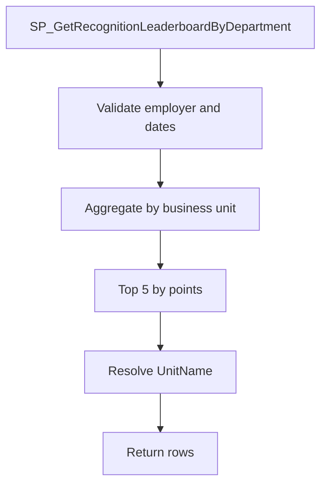

# SP_GetRecognitionLeaderboardByDepartment

## What it does

Returns the top five business units for an employer by total approved recognition points. Optional location and date filters apply. Unit names come from `TOrgHierarchyDetails` for only those five ids (never `MAX` of snapshot names). Errors return an `apiStatus = ERROR` row.

## Parameters

| Name | Direction | What it is for |
|---|---|---|
| `@employer_id` | in | Employer scope. Must be greater than 0 |
| `@location_id` | in | Optional recipient location filter. Default null = all |
| `@start_date` | in | Optional inclusive created_at lower bound |
| `@end_date` | in | Optional exclusive upper bound via `created_at < DATEADD(DAY, 1, @end_date)` |

## Call sequence

Calls no other procedures or functions.

## Callers

No other procedure or function in `HRMS-RewardNRecognition/STORED_PROCEDURE` executes this object. App callers live in the Rewards_and_Recognition backend that is not in this SourceCode checkout.

| Object | Kind | Page |
|---|---|---|
| Leaderboard React / RnR API | app | [Leaderboard](/docs/guides/reward-and-recognition/leaderboard) (host only; API not in checkout) |

## Nested

Calls no other procedures or functions.

## Steps

In `HRMS-DATABASE/HRMS-RewardNRecognition/STORED_PROCEDURE/SP_GetRecognitionLeaderboardByDepartment.sql`:

1. Reject null or non-positive `@employer_id` and reject `@start_date` after `@end_date`.
2. Aggregate approved active recognitions with a non-null `recipient_business_unit_id`, joined to `TEmployee` for the employer, into department stats (distinct employees, recognition count, total points, average points per employee).
3. Take `TOP (5)` departments ordered by total points then recognition count.
4. Join those five unit ids to `TOrgHierarchyDetails` for display names (fallback `Business Unit {id}`).
5. On error, return `ERROR` metadata columns.

## Tables

| Table | Read or write |
|---|---|
| `dbo.TEmployeeRecognition` | read |
| `dbo.TEmployee` | read (synonym → HRMS) |
| `dbo.TOrgHierarchyDetails` | read (synonym → HRMS) |

## Flow

