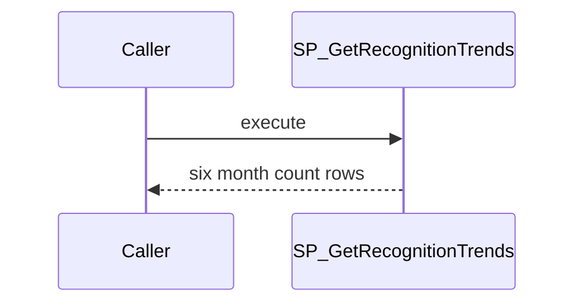
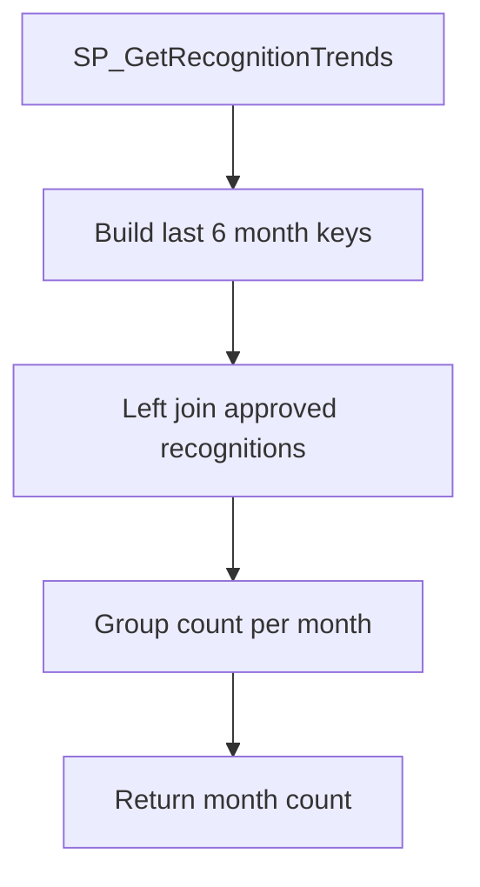

# SP_GetRecognitionTrends

## What it does

Returns recognition counts for the last six calendar months for one employer. Builds month keys with a small tally CTE, left-joins approved `TEmployeeRecognition` rows by year/month of `created_at`, and returns `month` (`yyyy-MM`) plus `count` (zero when no rows). Ordered ascending by month.

## Parameters

| Name | Direction | What it is for |
|---|---|---|
| `@employer_id` | in | Employer scope |

## Call sequence

## Callers

No other procedure or function executes this object. App callers: `serviceGetRecognitionTrends` → `GET /employee-recognitions/dashboard/trends` from [Recognition Dashboard](/docs/guides/reward-and-recognition/recognition-dashboard).

## Nested

Calls no other procedures or functions.

## Steps

1. Script is `HRMS-DATABASE/HRMS-RewardNRecognition/STORED_PROCEDURE/SP_GetRecognitionTrends.sql`.
2. Generate six month starts via a Values tally (`Numbers` / `Last6Months`).
3. Left join `TEmployeeRecognition` where `employer_id` matches, `status = 'approved'`, and year/month match the month start.
4. Group by month key and return counts ordered by month ascending.

## Tables

| Table | Read or write |
|---|---|
| `dbo.TEmployeeRecognition` | read |

## Unresolved calls

None.

## Flow

