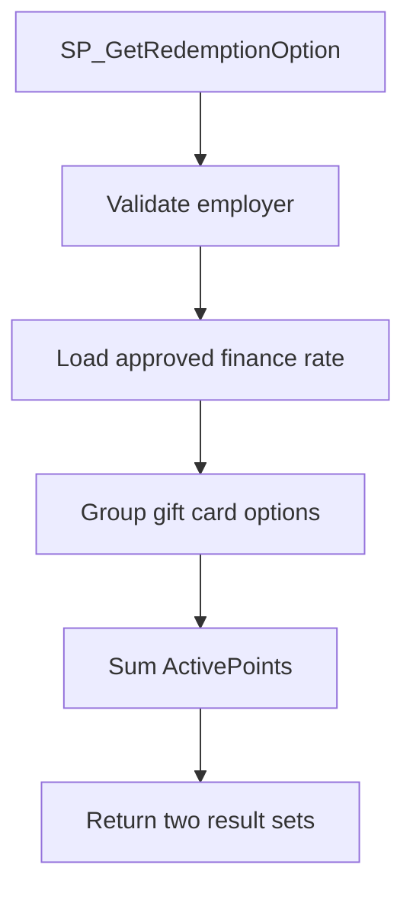

# SP_GetRedemptionOption

## What it does

Builds the employee Marketplace gift-card catalog for one employer. It loads the approved finance `pointToCurrencyRate`, groups unredeemed active `TRedemptionOption` rows whose category name matches `%gift%card%`, prices each title/value with `CEILING(Value * rate)`, optionally filters by category and point range, and returns available unit counts. A second result set returns the employee’s total approved `ActivePoints` (0 when `@EmployeeID` is null or has no balance). Throws when employer id or the approved rate is missing/invalid.

## Parameters

| Name | Direction | What it is for |
|---|---|---|
| `@EmployerID` | in | Employer scope. Must be greater than 0 |
| `@EmployeeID` | in | Optional recipient for the ActivePoints second set. Default null |
| `@CategoryId` | in | Optional redemption category filter. Default null = all gift-card categories |
| `@MinPoints` | in | Optional minimum priced points. Default null |
| `@MaxPoints` | in | Optional maximum priced points. Default null |

## Call sequence

```mermaid
sequenceDiagram
  participant Caller
  participant Main as SP_GetRedemptionOption
  participant Fin as TFinanceConfiguration
  participant Opt as TRedemptionOption
  participant Rec as TEmployeeRecognition
  Caller->>Main: execute
  Main->>Fin: approved pointToCurrencyRate
  Main->>Opt: group gift card options with price
  Main->>Rec: sum ActivePoints for employee
  Main-->>Caller: catalog set then balance set
```

## Callers

No other procedure or function in `HRMS-RewardNRecognition/STORED_PROCEDURE` executes this object. App callers live in the Rewards_and_Recognition backend that is not in this SourceCode checkout.

| Object | Kind | Page |
|---|---|---|
| Marketplace React / RnR API | app | [Marketplace](/docs/guides/reward-and-recognition/marketplace) (host only; API not in checkout) |

## Nested

None.

## Steps

In `HRMS-DATABASE/HRMS-RewardNRecognition/STORED_PROCEDURE/SP_GetRedemptionOption.sql`:

1. Reject null or non-positive `@EmployerID`.
2. Read approved `pointToCurrencyRate` from `TFinanceConfiguration`; throw if missing or not positive.
3. Select grouped unredeemed active options joined to categories where `CategoryName` matches gift-card pattern; compute `PointsRequired` via `CEILING(Value * rate)`; apply optional category/min/max filters; order by title then value.
4. Select `SUM(ActivePoints)` for approved recognitions for `@EmployeeID` / `@EmployerID` (null employee yields 0).

## Tables

| Table | Read or write |
|---|---|
| `dbo.TFinanceConfiguration` | read |
| `dbo.TRedemptionOption` | read |
| `dbo.TRedemptionCategory` | read |
| `dbo.TEmployeeRecognition` | read |

## Flow


