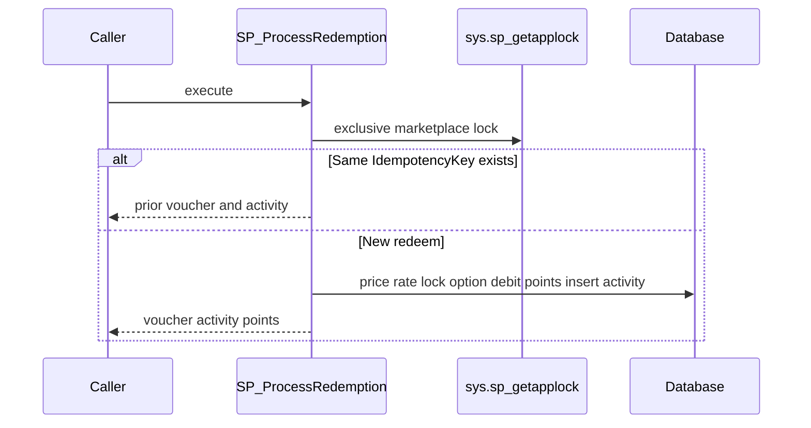
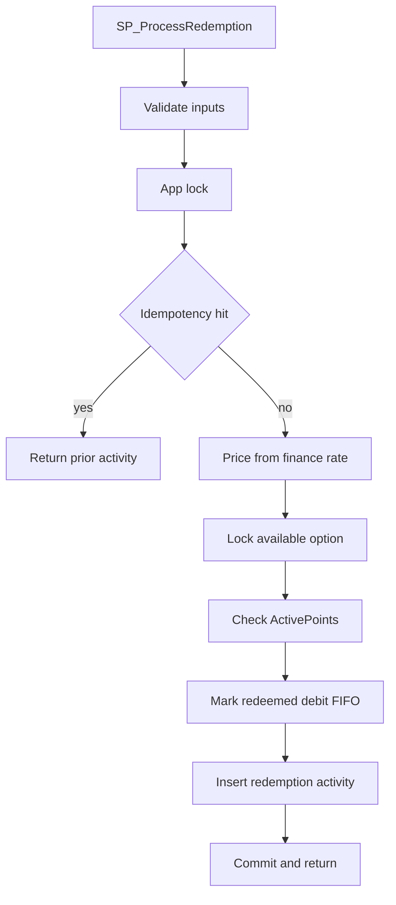

# SP_ProcessRedemption

## What it does

Idempotently redeems one gift-card unit for an employee. Inside a transaction it takes an exclusive `sys.sp_getapplock` keyed by employer/employee/idempotency key, returns the prior activity when the same key already redeemed the same title/category/value, otherwise prices `@Value` from the approved finance rate (must match `@ExpectedPoints`), locks an available unredeemed option with a voucher code, verifies enough approved `ActivePoints`, marks the option redeemed, FIFO-debits recognition rows, inserts `TEmployeeRedemptionActivity`, and returns voucher code / activity id / points charged. Does **not** call `SP_RnR_CreateFulfillmentItems`.

## Parameters

| Name | Direction | What it is for |
|---|---|---|
| `@EmployeeID` | in | Redeeming employee. Must be greater than 0 |
| `@EmployerID` | in | Employer scope. Must be greater than 0 |
| `@Title` | in | Gift-card title matching `TRedemptionOption.Title` |
| `@CategoryID` | in | Redemption category id |
| `@Value` | in | Monetary face value. Must be &gt; 0 and ≤ 100000 |
| `@ExpectedPoints` | in | Client-quoted points; must equal `CEILING(Value * rate)` |
| `@IdempotencyKey` | in | Required unique key per employee for safe retries |

## Call sequence

## Callers

No other procedure or function in `HRMS-RewardNRecognition/STORED_PROCEDURE` executes this object. App callers live in the Rewards_and_Recognition backend that is not in this SourceCode checkout.

| Object | Kind | Page |
|---|---|---|
| Marketplace React / RnR API | app | [Marketplace](/docs/guides/reward-and-recognition/marketplace) (host only; API not in checkout) |

## Nested

| Object | Kind | When | Page |
|---|---|---|---|
| `sys.sp_getapplock` | system procedure | Start of the redeem transaction | (SQL Server system — no Backstage page) |

## Steps

In `HRMS-DATABASE/HRMS-RewardNRecognition/STORED_PROCEDURE/SP_ProcessRedemption.sql`:

1. Validate employee, employer, title, category, value, expected points, and idempotency key; throw typed errors on failure.
2. Begin transaction; acquire exclusive applock `marketplace:{employer}:{employee}:{key}` (5s timeout).
3. If an activity already exists for the key, verify title/category/value match, commit, and return the prior voucher/activity/points.
4. Load approved finance rate; compute points; require equality with `@ExpectedPoints`.
5. Lock the oldest matching unredeemed active option with a non-blank voucher; throw if none.
6. Sum approved `ActivePoints`; throw if insufficient.
7. Mark option redeemed; FIFO-update recognition rows until points charged; insert `TEmployeeRedemptionActivity`.
8. Commit and return voucher / activity id / points; on error close cursor if open, rollback, and rethrow.

## Tables

| Table | Read or write |
|---|---|
| `dbo.TEmployeeRedemptionActivity` | read + write |
| `dbo.TRedemptionOption` | read + write |
| `dbo.TFinanceConfiguration` | read |
| `dbo.TEmployeeRecognition` | read + write |

## Flow

