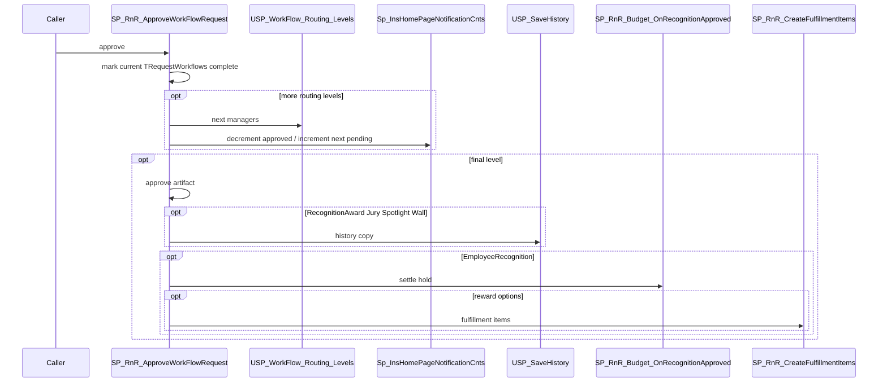
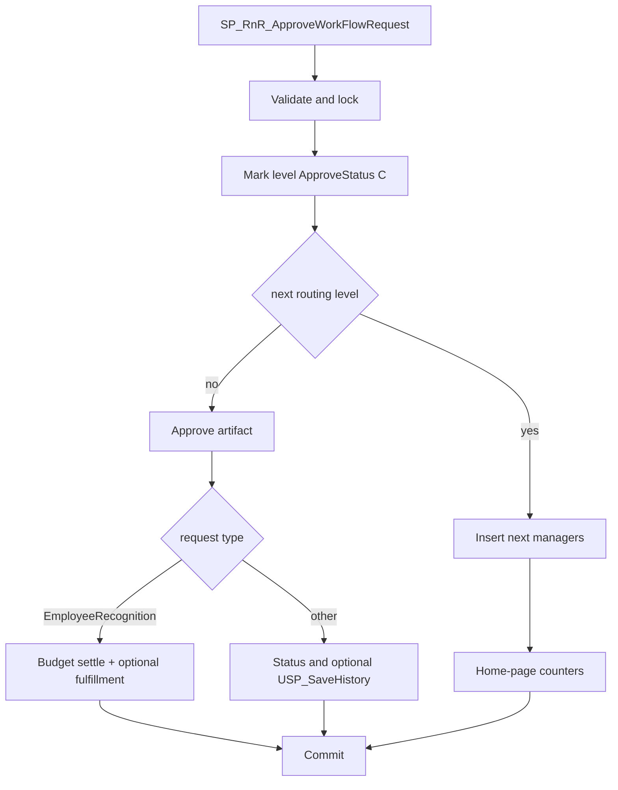

# SP_RnR_ApproveWorkFlowRequest

## What it does

Approves the current pending `TRequestWorkflows` row for a given RnR `@RequestType` / `@RequestTransId` / `@EmployeeId` / `@Employerid`. Marks the level complete (`ApproveStatus = 'C'`), optionally inserts the next routing level via `USP_WorkFlow_Routing_Levels`, adjusts home-page notification counts, and on final approval flips the artifact to approved (finance live config, recognition award type, jury, spotlight, wall of fame, or employee recognition). For **EmployeeRecognition** final approval it also settles budget holds (`SP_RnR_Budget_OnRecognitionApproved`), may create fulfillment items, and snapshots certificate template columns. Runs in one transaction with `SET XACT_ABORT ON`.

## Parameters

| Name | Direction | What it is for |
|---|---|---|
| `@RequestType` | in | Workflow request type (`RewardFinanceChange`, `RecognitionAward`, `JuryAward`, `SpotlightAward`, `WallOfFameAward`, `EmployeeRecognition`) |
| `@RequestTransId` | in | Artifact primary key / request id |
| `@EmployeeId` | in | Acting approver |
| `@comments` | in | Approval comment stored on the workflow row / artifact |
| `@Employerid` | in | Employer scope |
| `@EmployerLocalDate` | in | Optional; passed through to budget settle |

## Call sequence

## Callers

No other procedure in `HRMS-RewardNRecognition/STORED_PROCEDURE` executes this object (backups and auto-approve paths are separate scripts). App callers live in the Rewards_and_Recognition backend that is not in this SourceCode checkout.

| Object | Kind | Page |
|---|---|---|
| Notifications React / RnR API | app | [Notifications](/docs/guides/reward-and-recognition/notifications) (host only; API not in checkout) |

## Nested

| Object | Kind | When | Page |
|---|---|---|---|
| `USP_WorkFlow_Routing_Levels` | procedure | next approval level exists | [USP_WorkFlow_Routing_Levels](/docs/database/hrms/USP_WorkFlow_Routing_Levels) |
| `Sp_InsHomePageNotificationCnts` | procedure | counter deltas (also misspelled `Sp_InsHomePageNotIficationCnts` call sites) | [Sp_InsHomePageNotificationCnts](/docs/database/hrms/Sp_InsHomePageNotificationCnts) |
| `USP_SaveHistory` | procedure (RnR synonym → HRMS) | mid/final history on several award types | Synonym only — no baseline CREATE page |
| `SP_RnR_Budget_OnRecognitionApproved` | procedure | final EmployeeRecognition | [SP_RnR_Budget_OnRecognitionApproved](/docs/database/hrms-rewardnrecognition/SP_RnR_Budget_OnRecognitionApproved) |
| `SP_RnR_CreateFulfillmentItems` | procedure | final ER with reward option ids | [SP_RnR_CreateFulfillmentItems](/docs/database/hrms-rewardnrecognition/SP_RnR_CreateFulfillmentItems) |
| `FN_GetEmployeeName_Multi` | function | status / history text | [FN_GetEmployeeName_Multi](/docs/database/hrms/FN_GetEmployeeName_Multi) |
| `Fn_GetHomePageNotificationIdByRequestType` | function | home notification id | [Fn_GetHomePageNotificationIdByRequestType](/docs/database/hrms/Fn_GetHomePageNotificationIdByRequestType) |
| `FN_CM_GetMgrFromRequestWorkflows` | function | pending manager list for counters | [FN_CM_GetMgrFromRequestWorkflows](/docs/database/hrms/FN_CM_GetMgrFromRequestWorkflows) |

## Steps

In `HRMS-DATABASE/HRMS-RewardNRecognition/STORED_PROCEDURE/SP_RnR_ApproveWorkFlowRequest.sql`:

1. Validate parameters; begin transaction.
2. For EmployeeRecognition, lock and require `pending_approval` plus a pending workflow row for this manager.
3. Resolve request owner / employer by request type; resolve home-page notification id (`RnRFinanceChange` alias for finance).
4. Mark current-level workflow rows complete for this manager (and peers at the level).
5. If another routing level exists, call `USP_WorkFlow_Routing_Levels`, insert next `TRequestWorkflows` rows, adjust home-page counts, seed `TEmailNotification`.
6. On final level, apply type-specific approve updates; call history / budget / fulfillment as listed above; snapshot certificate columns when attached.
7. Commit; on error rollback and throw.

## Tables

| Table | Read or write |
|---|---|
| `dbo.TRequestWorkflows` | read / write |
| `dbo.TWorkflowDetails` | read |
| `dbo.TFinanceConfigurationRequest` | read / write |
| `dbo.TFinanceConfigurationRequestStatusHistory` | write |
| `dbo.TFinanceConfiguration` | read / write |
| `dbo.TRecognitionAwardTypesMaster` | read / write |
| `dbo.TJuryAwards` | read / write |
| `dbo.TEmployeeSpotlights` | read / write |
| `dbo.TWallOfFame` | read / write |
| `dbo.TEmployeeRecognition` | read / write |
| `dbo.TEmployeeRecognitionStatusHistory` | write |
| `dbo.TEmailNotification` | write |

## Unresolved calls

`USP_SaveHistory` body is not inventoried as a baseline CREATE script in this workspace (RnR synonym to HRMS).

## Flow

