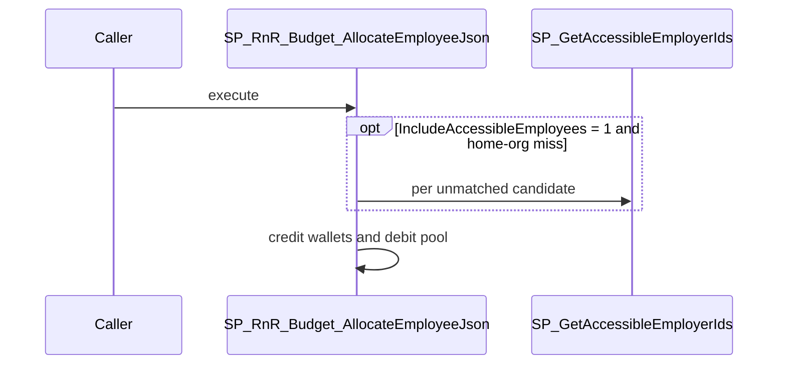
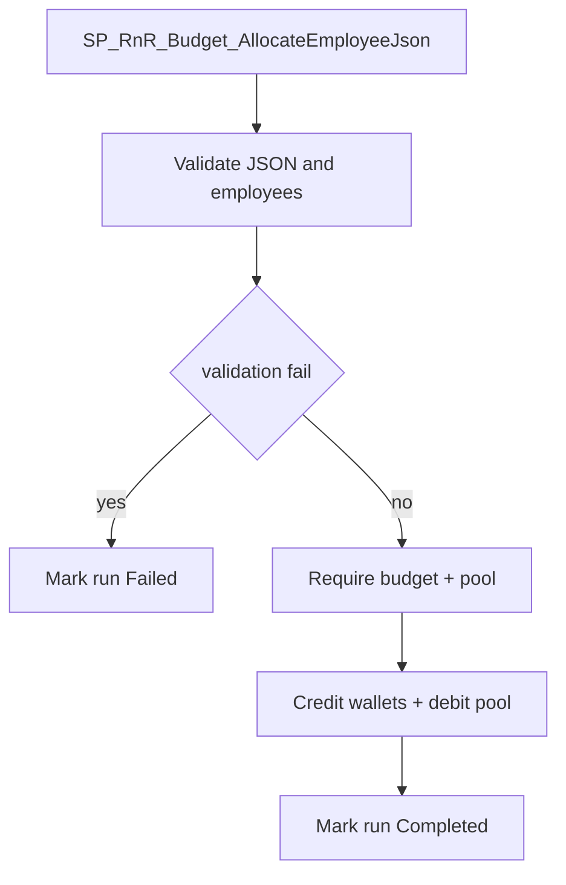

# SP_RnR_Budget_AllocateEmployeeJson

## What it does

Credits give-wallet batches for a JSON array of employee ids under one allocation run. Validates JSON uniqueness, matches active home-org employees (optionally expanding via `SP_GetAccessibleEmployerIds` when `@IncludeAccessibleEmployees = 1`), requires Budget Control and sufficient organisation pool balance, resolves expiry days (run → schedule → org default → 90), inserts wallet batches and Credit movements, queues AllocationCredit notifications, records run employees, debits the org pool, and marks the run Completed. Validation failures set the run to Failed with a reason and return without throwing.

## Parameters

| Name | Direction | What it is for |
|---|---|---|
| `@EmployerId` | in | Employer / pool scope |
| `@RunId` | in | `TRnRBudgetAllocationRun` to complete or fail |
| `@EmployeeIdsJson` | in | JSON array of employee ids |
| `@PointsPerEmployee` | in | Points credited per employee |
| `@SourceType` | in | Source stamped on wallet batches and movements (e.g. `PointRequest`) |
| `@CreatedBy` | in | Actor for batch / movement / pool audit |
| `@IncludeAccessibleEmployees` | in | When 1, allow active employees who can access the employer via accessible-employer lookup. Default 0 |

## Call sequence

## Callers

| Object | Kind | Page |
|---|---|---|
| `SP_RnR_Budget_DecidePointRequest` | procedure | [SP_RnR_Budget_DecidePointRequest](/docs/database/hrms-rewardnrecognition/SP_RnR_Budget_DecidePointRequest) |
| `SP_RnR_Budget_ProcessDueWork` | procedure | No page yet |
| `SP_RnR_Budget_CreateAccessibleAdHocAllocation` | procedure | No page yet |
| `SP_RnR_Budget_CreateAdHocAllocation` | procedure | No page yet |

## Nested

| Object | Kind | When | Page |
|---|---|---|---|
| `SP_GetAccessibleEmployerIds` | procedure | `@IncludeAccessibleEmployees = 1` for candidates not already matched in-home | No page yet |

## Steps

In `HRMS-DATABASE/HRMS-RewardNRecognition/STORED_PROCEDURE/SP_RnR_Budget_AllocateEmployeeJson.sql`:

1. Fail the run if `@EmployeeIdsJson` is not valid JSON or ids are not unique positive integers.
2. Match requested ids to active `TEmployee` rows for the employer.
3. If include-accessible is on, for unmatched candidates EXEC `SP_GetAccessibleEmployerIds` and add those who can access `@EmployerId`.
4. Fail the run if any requested employee still unmatched, count is zero, or points per employee ≤ 0.
5. Begin transaction; fail if Budget Control is off or org pool balance is insufficient.
6. Resolve `@ExpiryDays` from run, then schedule, then config (default 90); `-1` means never expire.
7. Insert `TRnRGiveWalletBatch` rows, Credit movements, AllocationCredit dispatch, and run-employee Completed rows.
8. Debit org pool, insert Allocation pool movement, mark run Completed, commit.

## Tables

| Table | Read or write |
|---|---|
| `dbo.TRnRBudgetAllocationRun` | read / write |
| `dbo.TEmployee` | read |
| `dbo.TRnRBudgetConfiguration` | read |
| `dbo.TRnROrganisationPool` | read / write |
| `dbo.TRnRBudgetSchedule` | read |
| `dbo.TRnRGiveWalletBatch` | write |
| `dbo.TRnRGiveWalletMovement` | write |
| `dbo.TRnRBudgetNotificationDispatch` | write |
| `dbo.TRnRBudgetAllocationRunEmployee` | write |
| `dbo.TRnROrganisationPoolMovement` | write |

## Flow

