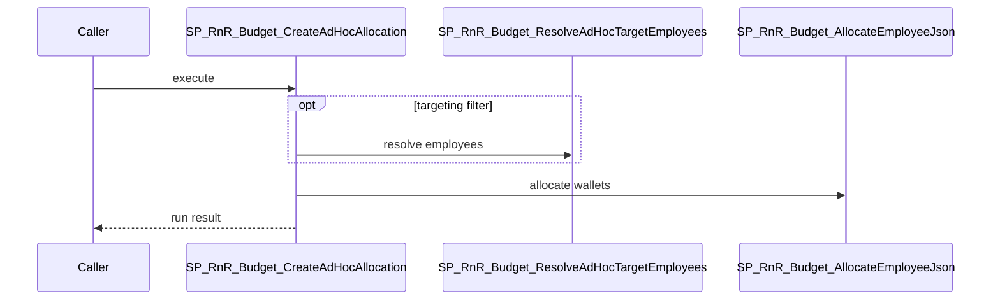
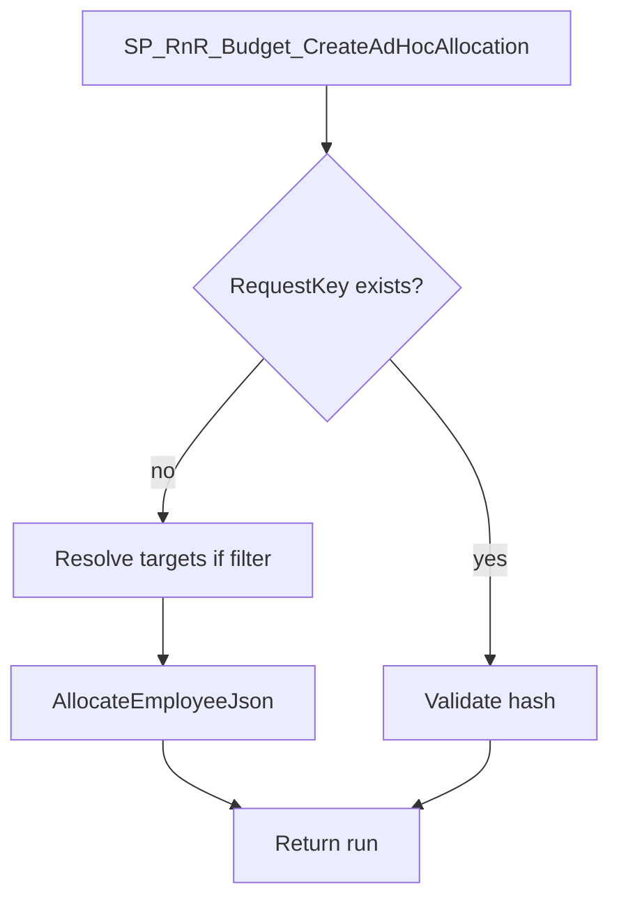

# SP_RnR_Budget_CreateAdHocAllocation

## What it does

Creates an idempotent ad-hoc give-wallet allocation run keyed by `@RequestKey` / `@RequestHash`. Resolves employees from explicit JSON or targeting JSON (`SP_RnR_Budget_ResolveAdHocTargetEmployees`), inserts `TRnRBudgetAllocationRun`, then allocates via `SP_RnR_Budget_AllocateEmployeeJson`. Enriches insufficient-pool failure messages with shortfall detail.

## Parameters

| Name | Direction | What it is for |
|---|---|---|
| `@EmployerId` | in | Employer scope |
| `@Name` | in | Run name |
| `@PointsPerEmployee` | in | Points each employee receives |
| `@EmployeeIdsJson` | in | Explicit employee id JSON array |
| `@TargetingJson` | in | Optional filter JSON (mutually exclusive with employees) |
| `@Reason` | in | Reason (1–500 chars) |
| `@ExpiryDays` | in | Optional `-1` or 30/90/180/365 |
| `@CreatedBy` | in | Acting user |
| `@RequestKey` / `@RequestHash` | in | Idempotency key + hash |

## Call sequence

## Callers

No other procedure executes this object. App callers: Admin Console Ad-hoc Allocations.

## Nested

| Object | Kind | When |
|---|---|---|
| `SP_RnR_Budget_ResolveAdHocTargetEmployees` | procedure | when `@TargetingJson` is used on first create |
| `SP_RnR_Budget_AllocateEmployeeJson` | procedure | on first create after run insert |

## Steps

1. Script is `HRMS-DATABASE/HRMS-RewardNRecognition/STORED_PROCEDURE/SP_RnR_Budget_CreateAdHocAllocation.sql`.
2. Validate key, points, reason, expiry, and exclusive selection methods.
3. If request key exists with matching hash, treat as idempotent replay; mismatch throws.
4. Else resolve targets if needed, insert Processing run, allocate, and adjust failure text for pool shortfall.

## Tables

| Table | Read or write |
|---|---|
| `dbo.TRnRBudgetAllocationRun` | read/write |
| `dbo.TRnROrganisationPool` | read on shortfall message |

## Unresolved calls

None at one nested level (`SP_RnR_Budget_ResolveTargetEmployees` is nested from ResolveAdHoc, level 2).

## Flow

