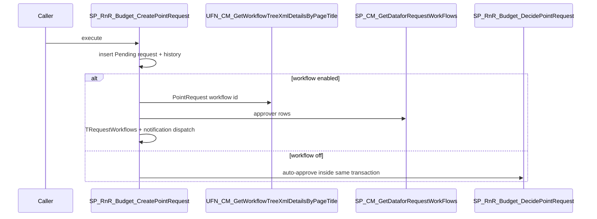
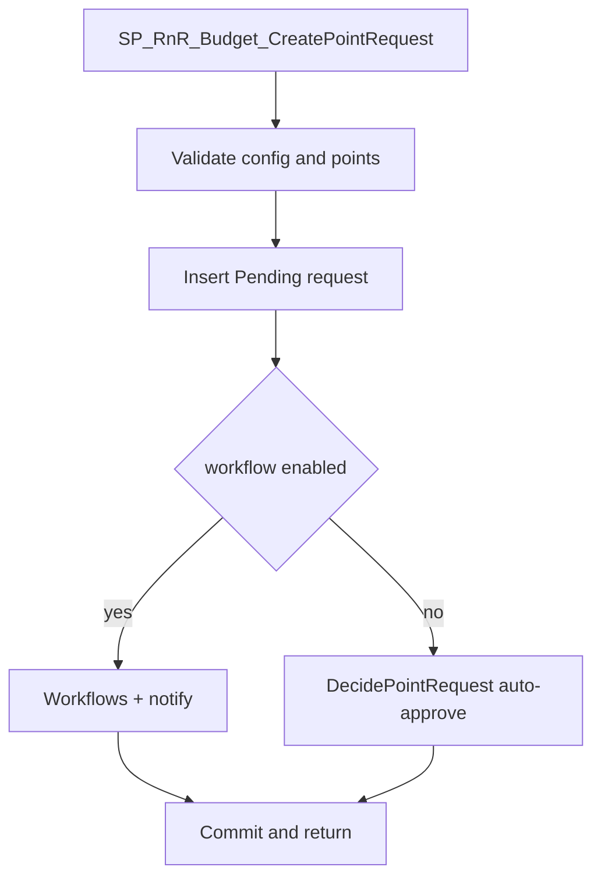

# SP_RnR_Budget_CreatePointRequest

## What it does

Submits a give-wallet point request when Budget Control and Point Requests are enabled. Inserts `TRnRPointRequest` (Pending) with wallet balance-at-request and status history. When Point Request workflow is on, resolves the workflow id via `UFN_CM_GetWorkflowTreeXmlDetailsByPageTitle`, loads approvers into `TRequestWorkflows`, and queues `PointRequestSubmitted` notification dispatch rows. When workflow is off, atomically `EXEC`s `SP_RnR_Budget_DecidePointRequest` to auto-approve and allocate. Returns the new request row.

## Parameters

| Name | Direction | What it is for |
|---|---|---|
| `@EmployerId` | in | Employer scope |
| `@EmployeeId` | in | Requester |
| `@RequestedPoints` | in | Points requested. Must be greater than 0 |
| `@Reason` | in | Request reason text |
| `@NeededBy` | in | Optional needed-by date; cannot be before employer-local (or UTC) today |
| `@EmployerLocalDate` | in | Optional “today” for needed-by validation |

## Call sequence

## Callers

No other procedure or function in `HRMS-RewardNRecognition/STORED_PROCEDURE` executes this object. App callers live in the Rewards_and_Recognition backend that is not in this SourceCode checkout.

| Object | Kind | Page |
|---|---|---|
| Give Recognition React / RnR API | app | [Give Recognition](/docs/guides/reward-and-recognition/give-recognition) (host only; API not in checkout) |

## Nested

| Object | Kind | When | Page |
|---|---|---|---|
| `UFN_CM_GetWorkflowTreeXmlDetailsByPageTitle` | function | Point Request workflow enabled | [UFN_CM_GetWorkflowTreeXmlDetailsByPageTitle](/docs/database/hrms/UFN_CM_GetWorkflowTreeXmlDetailsByPageTitle) |
| `SP_CM_GetDataforRequestWorkFlows` | procedure | Point Request workflow enabled | [SP_CM_GetDataforRequestWorkFlows](/docs/database/hrms/SP_CM_GetDataforRequestWorkFlows) |
| `SP_RnR_Budget_DecidePointRequest` | procedure | Point Request workflow disabled | [SP_RnR_Budget_DecidePointRequest](/docs/database/hrms-rewardnrecognition/SP_RnR_Budget_DecidePointRequest) |

## Steps

In `HRMS-DATABASE/HRMS-RewardNRecognition/STORED_PROCEDURE/SP_RnR_Budget_CreatePointRequest.sql`:

1. Reject non-positive points; reject past `@NeededBy`.
2. Require `TRnRBudgetConfiguration` with Budget Control and Point Requests enabled (reads expiry days).
3. Read `IsWorkflowEnabled` from `TRnRPointRequestWorkflowConfiguration`.
4. Begin transaction; insert Pending `TRnRPointRequest` with `BalanceAtRequest` from non-expired wallet batches; insert status history.
5. Workflow on: resolve workflow id; load approvers; require at least one; insert `TRequestWorkflows`; insert distinct `TRnRBudgetNotificationDispatch` rows for managers.
6. Workflow off: `EXEC SP_RnR_Budget_DecidePointRequest` with Approved, system allow, suppress result.
7. Commit; return the request row. On error, rollback and throw.

## Tables

| Table | Read or write |
|---|---|
| `dbo.TRnRBudgetConfiguration` | read |
| `dbo.TRnRPointRequestWorkflowConfiguration` | read |
| `dbo.TRnRGiveWalletBatch` | read |
| `dbo.TRnRPointRequest` | write |
| `dbo.TRnRPointRequestStatusHistory` | write |
| `dbo.TRequestWorkflows` | write |
| `dbo.TRnRBudgetNotificationDispatch` | write |

## Flow

