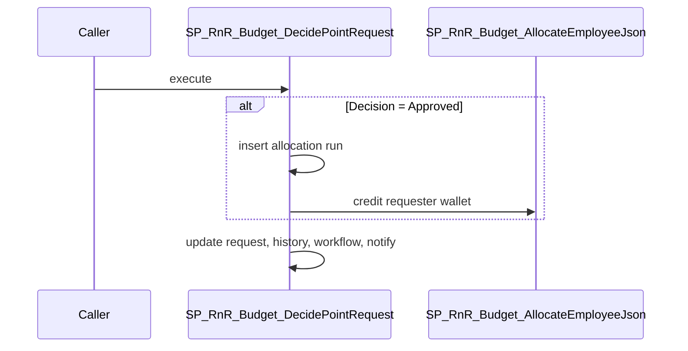
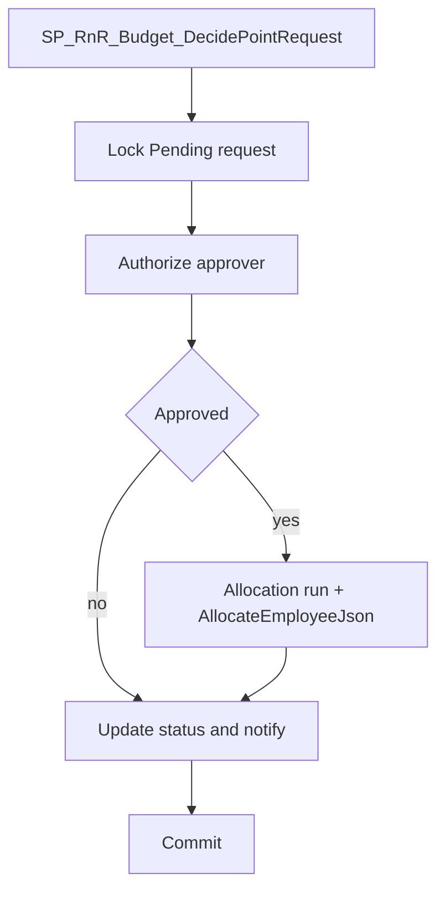

# SP_RnR_Budget_DecidePointRequest

## What it does

Approves or rejects a Pending `TRnRPointRequest`. Unless `@AllowSystem = 1`, the approver must have a pending `TRequestWorkflows` row for `PointRequest`. On Approve it creates a `TRnRBudgetAllocationRun` (source PointRequest, expiry from `PointRequestExpiryDays`) and `EXEC`s `SP_RnR_Budget_AllocateEmployeeJson` for the requester; a Failed run aborts with the run’s failure reason. Then it updates request status/decision fields, writes status history, closes pending workflow rows, and queues approved/rejected notification dispatch. Optional `@SuppressResult` skips the final select (used by create auto-approve).

## Parameters

| Name | Direction | What it is for |
|---|---|---|
| `@EmployerId` | in | Employer scope |
| `@PointRequestId` | in | Request to decide |
| `@ApproverId` | in | Approver (or system actor when allowed) |
| `@Decision` | in | `Approved` or `Rejected` |
| `@ApprovedPoints` | in | Points to grant when approving. Required positive and ≤ requested |
| `@Comments` | in | Required non-blank decision comments |
| `@AllowSystem` | in | When 1, skip workflow approver check. Default 0 |
| `@SuppressResult` | in | When 1, skip final result select. Default 0 |

## Call sequence

## Callers

| Object | Kind | Page |
|---|---|---|
| `SP_RnR_Budget_CreatePointRequest` | procedure | [SP_RnR_Budget_CreatePointRequest](/docs/database/hrms-rewardnrecognition/SP_RnR_Budget_CreatePointRequest) |
| `SP_RnR_Budget_SavePointRequestWorkflowConfiguration` | procedure | No page yet |

## Nested

| Object | Kind | When | Page |
|---|---|---|---|
| `SP_RnR_Budget_AllocateEmployeeJson` | procedure | `@Decision = 'Approved'` | [SP_RnR_Budget_AllocateEmployeeJson](/docs/database/hrms-rewardnrecognition/SP_RnR_Budget_AllocateEmployeeJson) |

## Steps

In `HRMS-DATABASE/HRMS-RewardNRecognition/STORED_PROCEDURE/SP_RnR_Budget_DecidePointRequest.sql`:

1. Require valid decision and non-blank comments. Begin transaction.
2. Lock the point request; require Pending; authorize approver unless `@AllowSystem = 1`.
3. On Approve, validate `@ApprovedPoints`; insert Processing allocation run; EXEC allocate for the single employee JSON; throw if run Status is Failed.
4. Update request Status / ApprovedPoints / decision audit columns.
5. Insert status history Pending → decision.
6. Update pending `TRequestWorkflows` to A/R.
7. Insert notification dispatch for the requester (Approved or Rejected) if not already sent.
8. Commit; optionally return decision result set. On error, rollback and throw.

## Tables

| Table | Read or write |
|---|---|
| `dbo.TRnRPointRequest` | read / write |
| `dbo.TRequestWorkflows` | read / write |
| `dbo.TRnRBudgetConfiguration` | read |
| `dbo.TRnRBudgetAllocationRun` | read / write |
| `dbo.TRnRPointRequestStatusHistory` | write |
| `dbo.TRnRBudgetNotificationDispatch` | write |

## Flow

