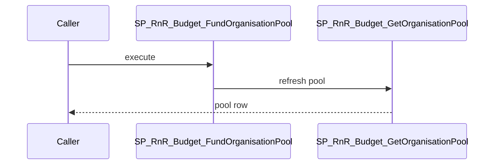
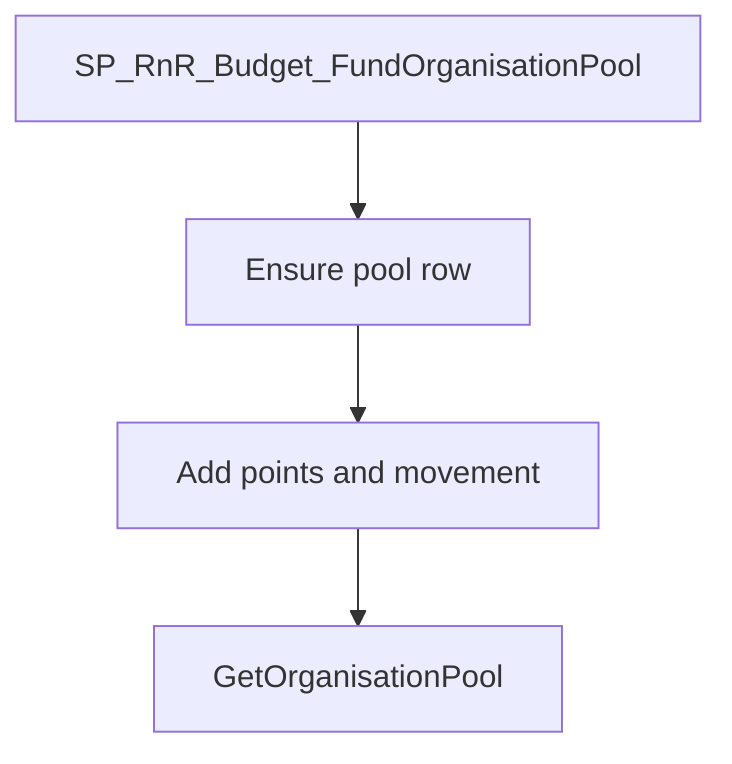

# SP_RnR_Budget_FundOrganisationPool

## What it does

Manually funds the employer organisation pool by `@Points`, ensuring a pool row exists, incrementing available/lifetime funded balances, writing a `Funded` movement, then returning the pool via `SP_RnR_Budget_GetOrganisationPool`.

## Parameters

| Name | Direction | What it is for |
|---|---|---|
| `@EmployerId` | in | Employer scope |
| `@Points` | in | Points to add (must be > 0) |
| `@Comments` | in | Funding comment |
| `@CreatedBy` | in | Acting user |

## Call sequence

## Callers

No other procedure executes this object. App callers: Admin Console Organisation Pool funding.

## Nested

| Object | Kind | When |
|---|---|---|
| `SP_RnR_Budget_GetOrganisationPool` | procedure | always after commit |

## Steps

1. Script is `HRMS-DATABASE/HRMS-RewardNRecognition/STORED_PROCEDURE/SP_RnR_Budget_FundOrganisationPool.sql`.
2. Reject non-positive points.
3. Ensure pool row; update balances; insert movement.
4. Commit; execute `SP_RnR_Budget_GetOrganisationPool`.

## Tables

| Table | Read or write |
|---|---|
| `dbo.TRnROrganisationPool` | read/write |
| `dbo.TRnROrganisationPoolMovement` | write |

## Unresolved calls

None.

## Flow

