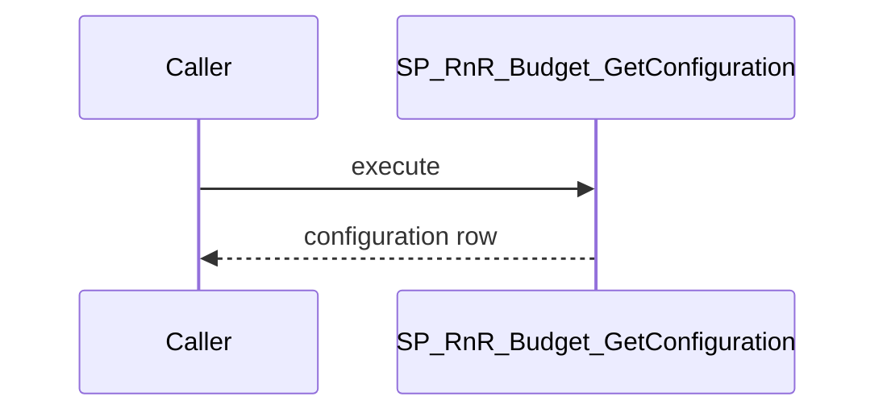
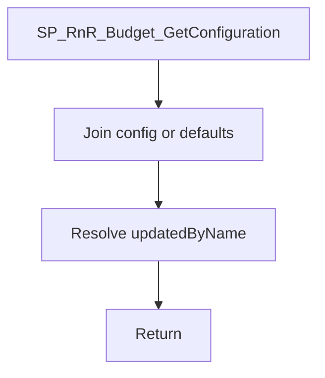

# SP_RnR_Budget_GetConfiguration

## What it does

Returns budget-control configuration for an employer (or defaults when no row), including Budget Control / new-joiner / point-request flags and resolved `updatedByName` via `Fn_GetEmployeeName` + employment number.

## Parameters

| Name | Direction | What it is for |
|---|---|---|
| `@EmployerId` | in | Employer scope |

## Call sequence

## Callers

Called by `SP_RnR_Budget_SaveConfiguration` after save. Also expected as a direct Admin Console Budget Configuration read.

## Nested

| Object | Kind | When |
|---|---|---|
| `Fn_GetEmployeeName` | function | when UpdatedBy is present |

## Steps

1. Script is `HRMS-DATABASE/HRMS-RewardNRecognition/STORED_PROCEDURE/SP_RnR_Budget_GetConfiguration.sql`.
2. Left-join `TRnRBudgetConfiguration` for `@EmployerId` onto a seed row so defaults return when missing.
3. Resolve updater display name from `Fn_GetEmployeeName` and `TEmployeeInfo`.

## Tables

| Table | Read or write |
|---|---|
| `dbo.TRnRBudgetConfiguration` | read |
| `dbo.TEmployeeInfo` | read |

## Unresolved calls

None.

## Flow

