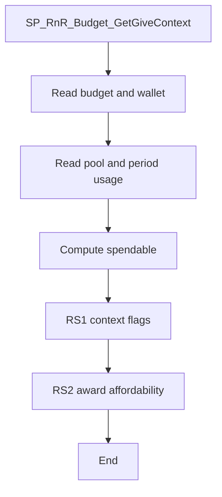

# SP_RnR_Budget_GetGiveContext

## What it does

Read-only give-budget context for one employee at one employer. Result set 1 returns budget-control flag, wallet available points (when control is on), organisation pool balance, point-requests enabled, and direct-issue enabled. Result set 2 returns each active award type with affordability, optional disabled reason, and max affordable points based on spendable balance (wallet when budget control is on; otherwise pool, optionally capped by direct-issue period usage). It does not write tables or call other procedures.

## Parameters

| Name | Direction | What it is for |
|---|---|---|
| `@EmployerId` | in | Employer scope |
| `@EmployeeId` | in | Giver whose wallet and direct-issue usage are read |
| `@AsOfDate` | in | Optional date for period bounds. Default UTC today |

## Call sequence

Calls no other procedures or functions.

## Callers

No other procedure or function in `HRMS-RewardNRecognition/STORED_PROCEDURE` executes this object. App callers live in the Rewards_and_Recognition backend that is not in this SourceCode checkout.

| Object | Kind | Page |
|---|---|---|
| Give Recognition React / RnR API | app | [Give Recognition](/docs/guides/reward-and-recognition/give-recognition) (host only; API not in checkout) |

## Nested

Calls no other procedures or functions.

## Steps

In `HRMS-DATABASE/HRMS-RewardNRecognition/STORED_PROCEDURE/SP_RnR_Budget_GetGiveContext.sql`:

1. Read `BudgetControlEnabled` from `TRnRBudgetConfiguration`.
2. Sum non-expired `TRnRGiveWalletBatch.AvailablePoints` for the employee into `@Wallet`.
3. Read organisation pool balance, direct-issue flag, limit, and period from `TRnROrganisationPool`.
4. Compute period start/end from `@AsOfDate` (Month / Quarter / Year) and load `TRnRDirectIssueUsage.UsedPoints` for that period.
5. Compute remaining direct-issue cap and `@Spendable` (wallet if budget control on; else min of pool and remaining cap when direct issue on; else pool).
6. Result set 1 — budget flags and balances.
7. Result set 2 — active `TRecognitionAwardTypesMaster` rows with `isAffordable`, `disabledReason`, and `maxAffordablePoints` by point type.

## Tables

| Table | Read or write |
|---|---|
| `dbo.TRnRBudgetConfiguration` | read |
| `dbo.TRnRGiveWalletBatch` | read |
| `dbo.TRnROrganisationPool` | read |
| `dbo.TRnRDirectIssueUsage` | read |
| `dbo.TRecognitionAwardTypesMaster` | read |

## Flow

