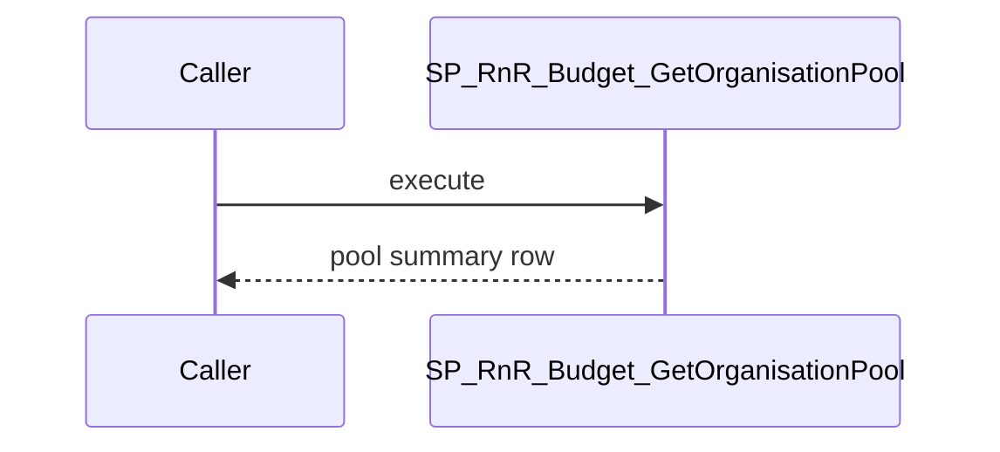
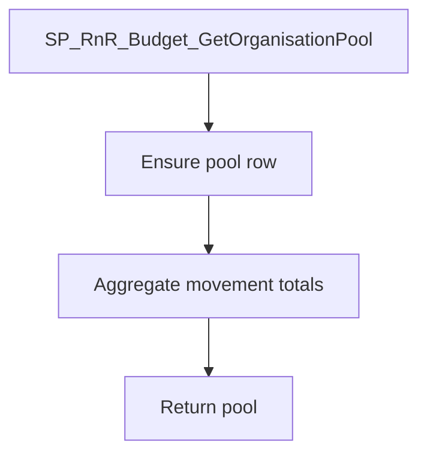

# SP_RnR_Budget_GetOrganisationPool

## What it does

Ensures an organisation pool row exists for the employer, then returns available/lifetime balances plus derived lifetime DirectIssue and PointRequest allocation totals, and direct-issue settings.

## Parameters

| Name | Direction | What it is for |
|---|---|---|
| `@EmployerId` | in | Employer scope |

## Call sequence

## Callers

Called by `SP_RnR_Budget_FundOrganisationPool`. Also expected as a direct Organisation Pool read from [Admin Console](/docs/guides/reward-and-recognition/admin-console).

## Nested

Calls no other procedures or functions.

## Steps

1. Script is `HRMS-DATABASE/HRMS-RewardNRecognition/STORED_PROCEDURE/SP_RnR_Budget_GetOrganisationPool.sql`.
2. Insert empty pool row if missing.
3. Aggregate DirectIssue and PointRequest allocation movements.
4. Select pool balances and settings.

## Tables

| Table | Read or write |
|---|---|
| `dbo.TRnROrganisationPool` | read/write (ensure insert) |
| `dbo.TRnROrganisationPoolMovement` | read |

## Unresolved calls

None.

## Flow

