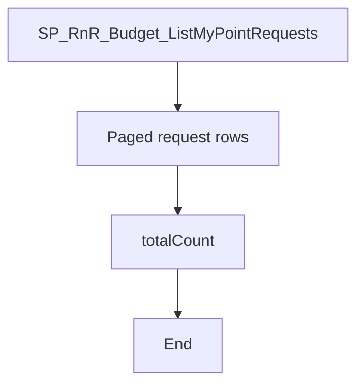

# SP_RnR_Budget_ListMyPointRequests

## What it does

Paged read of one employee’s point requests at one employer. Result set 1 returns matching `TRnRPointRequest` rows (optional status, reason search, created-date range) ordered by `CreatedAt` descending with `OFFSET`/`FETCH`. Result set 2 returns the matching `totalCount`. Parameter `@SourceType` is declared but not used in the query. Read-only; calls no other procedures.

## Parameters

| Name | Direction | What it is for |
|---|---|---|
| `@EmployerId` | in | Employer scope |
| `@EmployeeId` | in | Requester whose rows are listed |
| `@Search` | in | Optional substring match on `Reason` |
| `@Status` | in | Optional exact status filter |
| `@SourceType` | in | Declared; unused in the script body |
| `@FromDate` | in | Optional inclusive lower bound on `CreatedAt` |
| `@ToDate` | in | Optional inclusive calendar-day upper bound on `CreatedAt` |
| `@PageNumber` | in | 1-based page. Default 1 |
| `@PageSize` | in | Page size. Default 20 |

## Call sequence

Calls no other procedures or functions.

## Callers

No other procedure or function in `HRMS-RewardNRecognition/STORED_PROCEDURE` executes this object. App callers live in the Rewards_and_Recognition backend that is not in this SourceCode checkout.

| Object | Kind | Page |
|---|---|---|
| Give Recognition React / RnR API | app | [Give Recognition](/docs/guides/reward-and-recognition/give-recognition) (host only; API not in checkout) |

## Nested

Calls no other procedures or functions.

## Steps

In `HRMS-DATABASE/HRMS-RewardNRecognition/STORED_PROCEDURE/SP_RnR_Budget_ListMyPointRequests.sql`:

1. Select paged point-request columns for employer + employee with optional filters.
2. Select `COUNT_BIG(*)` with the same filters as `totalCount`.

## Tables

| Table | Read or write |
|---|---|
| `dbo.TRnRPointRequest` | read |

## Flow

