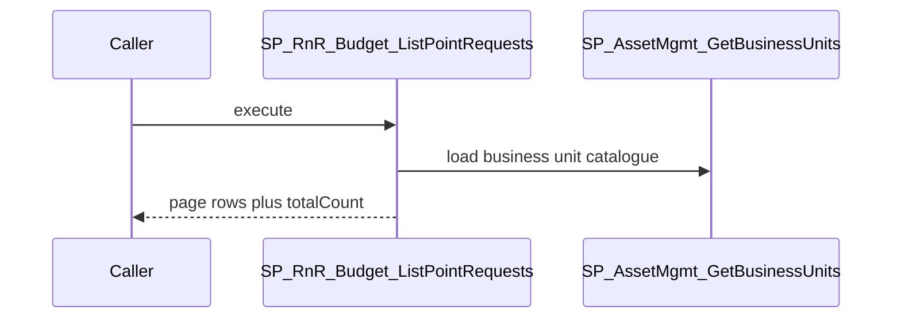
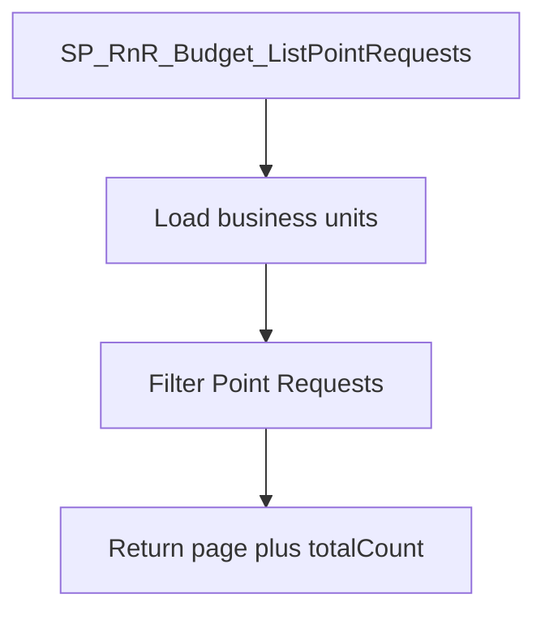

# SP_RnR_Budget_ListPointRequests

## What it does

Returns a paged list of `TRnRPointRequest` rows for an employer, with optional assigned-approver filter (`@AssignedApproverOnly` + `@ApproverId` against pending `TRequestWorkflows` of type `PointRequest`), status/search/date filters, business-unit names, wallet balance / quarterly usage columns, pending approver ids, and pool utilisation. A second result set returns `totalCount`. Throws when assigned-only is set without an approver id.

## Parameters

| Name | Direction | What it is for |
|---|---|---|
| `@EmployerId` | in | Employer scope |
| `@ApproverId` | in | Approver for assigned filter. Default null |
| `@AssignedApproverOnly` | in | When 1, restrict to requests involving `@ApproverId`. Default 0 |
| `@Search` | in | Reason or employee id search. Default null |
| `@Status` | in | Request status filter. Default null |
| `@SourceType` | in | Accepted; unused in body |
| `@FromDate` / `@ToDate` | in | CreatedAt window. Default null |
| `@PageNumber` / `@PageSize` | in | Paging. Defaults 1 / 20 |

## Call sequence

## Callers

No other procedure or function in `HRMS-RewardNRecognition/STORED_PROCEDURE` executes this object. App callers live in the Rewards_and_Recognition backend that is not in this SourceCode checkout.

| Object | Kind | Page |
|---|---|---|
| Notifications / Admin Point Request UI (RnR API) | app | [Notifications](/docs/guides/reward-and-recognition/notifications) (host only; API not in checkout) |

## Nested

| Object | Kind | When | Page |
|---|---|---|---|
| `SP_AssetMgmt_GetBusinessUnits` | procedure | Always (BU name catalogue) | [SP_AssetMgmt_GetBusinessUnits](/docs/database/hrms/SP_AssetMgmt_GetBusinessUnits) |

## Steps

In `HRMS-DATABASE/HRMS-RewardNRecognition/STORED_PROCEDURE/SP_RnR_Budget_ListPointRequests.sql`:

1. Validate assigned-approver parameters; compute quarter start and pool scalars.
2. `EXEC SP_AssetMgmt_GetBusinessUnits` into a temp catalogue; dedupe by UnitID.
3. Select paged `TRnRPointRequest` rows with joins/filters and derived balance / usage / pending-approver columns; pending status sorts first.
4. Select matching `totalCount`.

## Tables

| Table | Read or write |
|---|---|
| `dbo.TRnRPointRequest` | read |
| `dbo.TRequestWorkflows` | read |
| `dbo.TRnROrganisationPool` | read |
| `dbo.TRnRGiveWalletBatch` | read |
| `dbo.TRnRGiveWalletMovement` | read |
| `dbo.TRnRBudgetAllocationRun` / `TRnRBudgetAllocationRunEmployee` | read |
| `dbo.TEmployeeRecognition` | read |
| `dbo.TEmployeeInfo` | read |
| `dbo.TRnRBudgetConfiguration` | read |

## Flow

