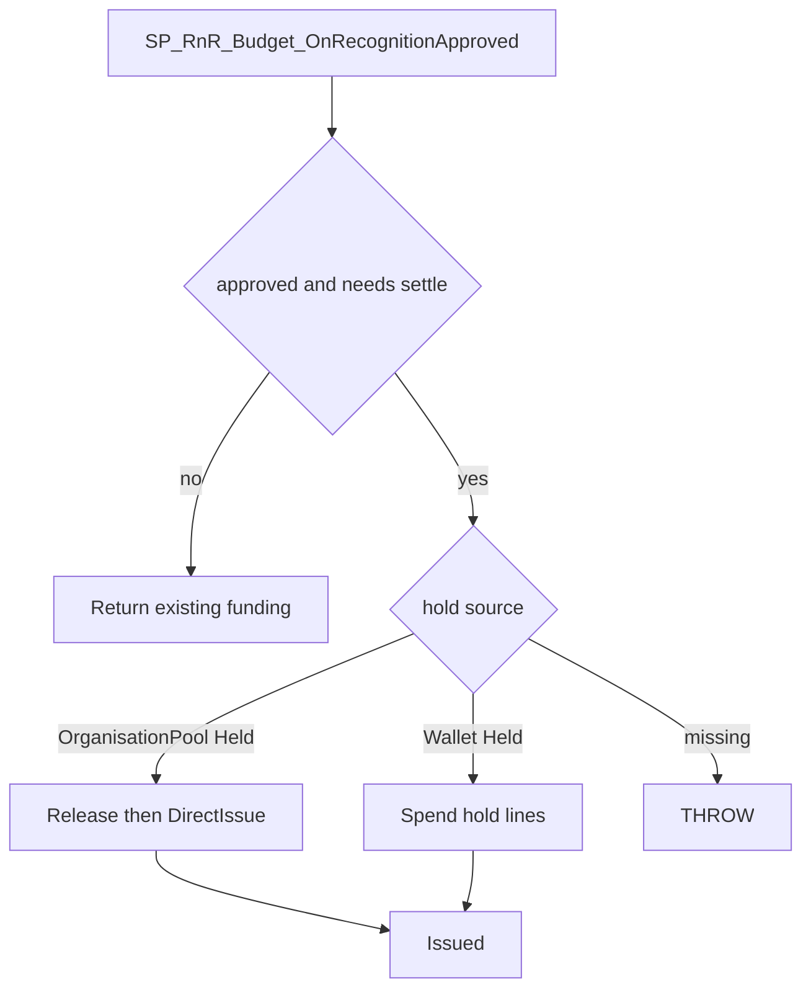

# SP_RnR_Budget_OnRecognitionApproved

## What it does

Settles a recognition funding hold when the recognition is approved. No-ops (returns existing funding) when status is not approved, when neither budget config nor organisation pool exists, or when funding is already `Issued` / `NoFunds`. For a Held organisation-pool hold it releases then re-debits as DirectIssue and marks the hold Spent. For a Held wallet hold it moves held points to spent on each batch (rejecting expired batches), records Spend movements, and sets recognition points / `funding_status = Issued`. Throws if there is no Held reservation when settle is required.

## Parameters

| Name | Direction | What it is for |
|---|---|---|
| `@EmployerId` | in | Employer scope |
| `@RecognitionId` | in | Recognition to settle |
| `@ActionedBy` | in | Actor for pool/wallet movement audit (also used as sender when called from submit with sender id) |
| `@EmployerLocalDate` | in | Optional; accepted but unused in the script body |

## Call sequence

Calls no other procedures or functions.

## Callers

| Object | Kind | Page |
|---|---|---|
| `SP_RnR_Budget_OnRecognitionSubmitted` | procedure | [SP_RnR_Budget_OnRecognitionSubmitted](/docs/database/hrms-rewardnrecognition/SP_RnR_Budget_OnRecognitionSubmitted) |
| `USP_RnR_AutoApprovePendingOnDisable` | procedure | No page yet |
| `SP_RnR_ApproveWorkFlowRequest` | procedure | No page yet |

## Nested

Calls no other procedures or functions.

## Steps

In `HRMS-DATABASE/HRMS-RewardNRecognition/STORED_PROCEDURE/SP_RnR_Budget_OnRecognitionApproved.sql`:

1. Begin transaction; lock recognition funding columns and status.
2. If status is not `approved`, or no budget config and no org pool, or funding already Issued/NoFunds: commit and return existing funding.
3. Load hold; fall back to recognition `requested_points` / `points` when no hold points.
4. Zero requested: set funding None/Issued and return.
5. Reject if a hold exists but is not `Held`.
6. OrganisationPool Held path: pool release + DirectIssue debit, mark hold Spent, set recognition Issued, return.
7. Wallet Held path: reject if any hold-line batch is expired; move Held→Spent on batches; insert Spend movements; mark hold Spent; set recognition Issued; return.
8. Otherwise throw insufficient wallet or missing pool reservation errors.

## Tables

| Table | Read or write |
|---|---|
| `dbo.TEmployeeRecognition` | read / write |
| `dbo.TRnRBudgetConfiguration` | read |
| `dbo.TRnROrganisationPool` | read / write |
| `dbo.TRnROrganisationPoolMovement` | write |
| `dbo.TRnRRecognitionPointHold` | read / write |
| `dbo.TRnRRecognitionPointHoldLine` | read |
| `dbo.TRnRGiveWalletBatch` | read / write |
| `dbo.TRnRGiveWalletMovement` | write |

## Flow

