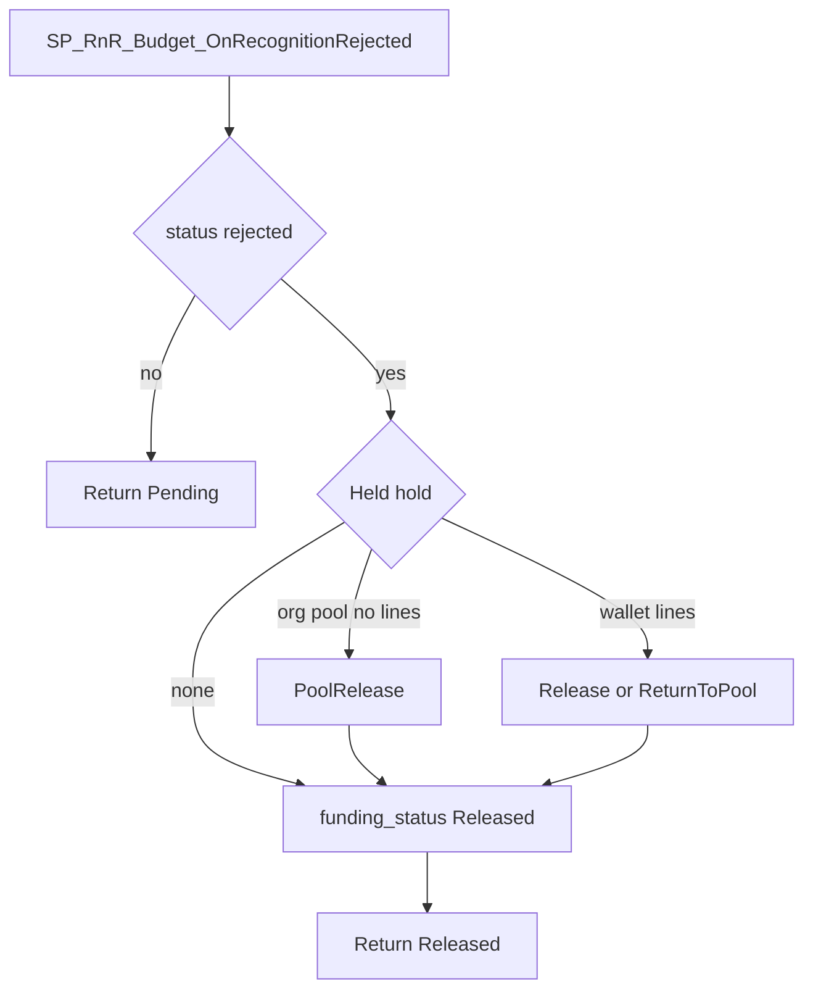

# SP_RnR_Budget_OnRecognitionRejected

## What it does

Releases a recognition funding hold after the recognition status is `rejected`. No-ops (returns `Pending` funding status) when the recognition is not rejected for the employer. For a Held organisation-pool hold without hold lines it credits the pool and adjusts direct-issue usage. For Held wallet hold lines it returns points to batches (or to the organisation pool when budget control is off / batch expired), writes wallet movements, marks the hold `Released`, and sets recognition `funding_status = 'Released'`. Returns a single-row result with `fundingStatus`.

## Parameters

| Name | Direction | What it is for |
|---|---|---|
| `@EmployerId` | in | Employer scope |
| `@RecognitionId` | in | Recognition whose hold is released |
| `@ActionedBy` | in | Actor for pool/wallet movement audit |

## Call sequence

Calls no other procedures or functions.

## Callers

| Object | Kind | Page |
|---|---|---|
| `SP_RnR_RejectWorkFlowRequest` | procedure | [SP_RnR_RejectWorkFlowRequest](/docs/database/hrms-rewardnrecognition/SP_RnR_RejectWorkFlowRequest) |

## Nested

Calls no other procedures or functions.

## Steps

In `HRMS-DATABASE/HRMS-RewardNRecognition/STORED_PROCEDURE/SP_RnR_Budget_OnRecognitionRejected.sql`:

1. Begin transaction; lock budget config and recognition.
2. If recognition is not `rejected` for the employer, commit and return `Pending`.
3. Load Held hold for the recognition.
4. OrganisationPool Held without hold lines: credit pool, insert PoolRelease movement, reduce direct-issue used points, mark hold Released.
5. Else if hold exists with lines: release points to wallet batches (or ReturnToPool), insert wallet movements, optionally credit organisation pool, mark hold Released.
6. Set recognition `funding_status = 'Released'`; commit; return `Released`.

## Tables

| Table | Read or write |
|---|---|
| `dbo.TRnRBudgetConfiguration` | read |
| `dbo.TEmployeeRecognition` | read / write |
| `dbo.TRnRRecognitionPointHold` | read / write |
| `dbo.TRnRRecognitionPointHoldLine` | read |
| `dbo.TRnROrganisationPool` | read / write |
| `dbo.TRnROrganisationPoolMovement` | write |
| `dbo.TRnRDirectIssueUsage` | write |
| `dbo.TRnRGiveWalletBatch` | write |
| `dbo.TRnRGiveWalletMovement` | write |

## Unresolved calls

None.

## Flow

