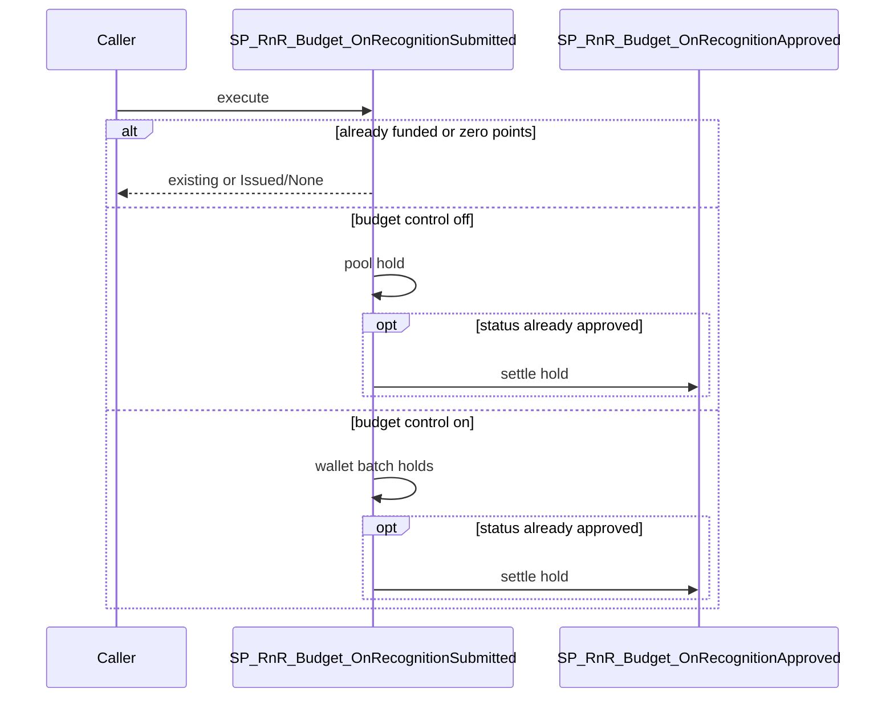
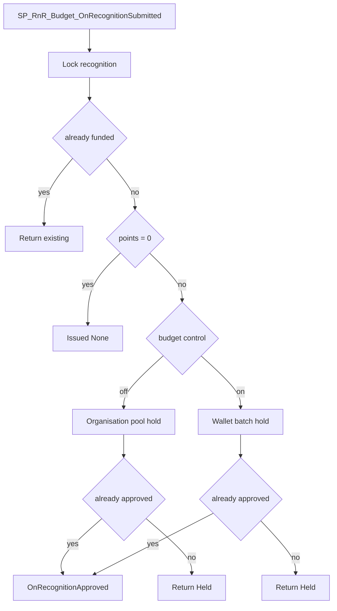

# SP_RnR_Budget_OnRecognitionSubmitted

## What it does

Applies give-budget funding after a recognition is created. Locks the recognition and budget config, sets requested points and funding source/status, then either short-circuits (already funded or zero points), holds against the organisation pool (budget control off), or holds wallet batches (budget control on). When the recognition status is already `approved`, it immediately `EXEC`s `SP_RnR_Budget_OnRecognitionApproved` inside the same transaction to settle the hold.

## Parameters

| Name | Direction | What it is for |
|---|---|---|
| `@EmployerId` | in | Employer scope |
| `@RecognitionId` | in | Recognition to fund |
| `@SenderEmployeeId` | in | Giver; must match `sender_employee_id` on the row |
| `@RequestedPoints` | in | Points to hold/issue. Must be non-negative |
| `@EmployerLocalDate` | in | Optional date for direct-issue period bounds |

## Call sequence

## Callers

No other procedure or function in `HRMS-RewardNRecognition/STORED_PROCEDURE` executes this object. App callers live in the Rewards_and_Recognition backend that is not in this SourceCode checkout.

| Object | Kind | Page |
|---|---|---|
| Give Recognition React / RnR API | app | [Give Recognition](/docs/guides/reward-and-recognition/give-recognition) (host only; API not in checkout) |

## Nested

| Object | Kind | When | Page |
|---|---|---|---|
| `SP_RnR_Budget_OnRecognitionApproved` | procedure | recognition `status` is already `approved` after hold | [SP_RnR_Budget_OnRecognitionApproved](/docs/database/hrms-rewardnrecognition/SP_RnR_Budget_OnRecognitionApproved) |

## Steps

In `HRMS-DATABASE/HRMS-RewardNRecognition/STORED_PROCEDURE/SP_RnR_Budget_OnRecognitionSubmitted.sql`:

1. Reject negative `@RequestedPoints`. Begin transaction.
2. Read budget-control flag and lock recognition for employer + sender; throw if missing.
3. If `funding_status` already `Held` / `Issued` / `NoFunds`, return existing funding columns and commit.
4. Update recognition `requested_points`, `funding_source`, and `funding_status` (None/Issued for zero points; Wallet/Held or OrganisationPool/Pending otherwise).
5. Zero points: return `None` / `Issued` and commit.
6. Budget control off: validate pool balance and optional direct-issue limit; debit pool; insert pool movement and hold; optional `TRnRDirectIssueUsage` merge; set recognition Held; if approved, EXEC `SP_RnR_Budget_OnRecognitionApproved`, else return Held result; commit.
7. Budget control on: validate wallet sum; insert hold and per-batch hold lines / movements (expiry-first); if approved, EXEC approve settle, else return Wallet Held; commit.

## Tables

| Table | Read or write |
|---|---|
| `dbo.TRnRBudgetConfiguration` | read |
| `dbo.TEmployeeRecognition` | read / write |
| `dbo.TRnROrganisationPool` | read / write |
| `dbo.TRnROrganisationPoolMovement` | write |
| `dbo.TRnRDirectIssueUsage` | read / write |
| `dbo.TRnRRecognitionPointHold` | write |
| `dbo.TRnRGiveWalletBatch` | read / write |
| `dbo.TRnRRecognitionPointHoldLine` | write |
| `dbo.TRnRGiveWalletMovement` | write |

## Flow

