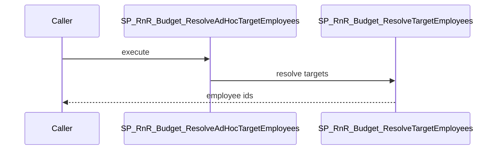
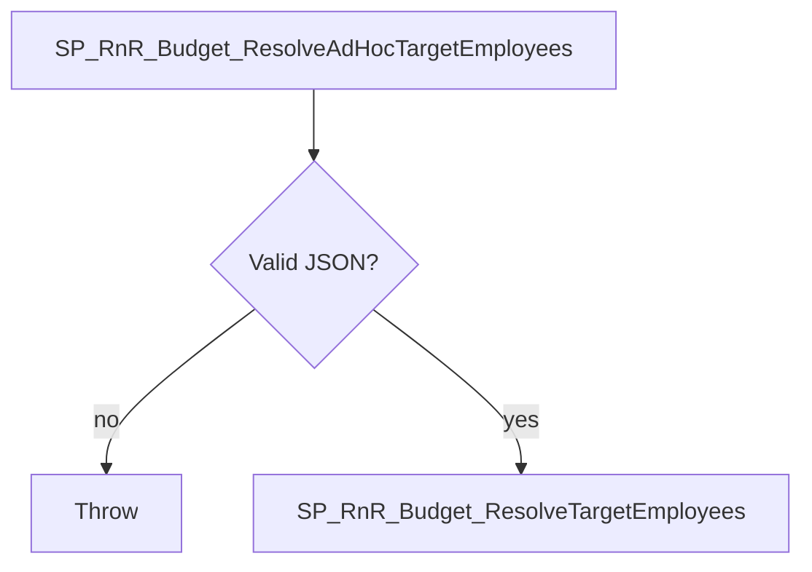

# SP_RnR_Budget_ResolveAdHocTargetEmployees

## What it does

Validates targeting JSON for an ad-hoc allocation and delegates employee resolution to `SP_RnR_Budget_ResolveTargetEmployees` so excluded employee ids are applied consistently with scheduled targeting.

## Parameters

| Name | Direction | What it is for |
|---|---|---|
| `@EmployerId` | in | Employer scope |
| `@TargetingJson` | in | Targeting criteria JSON |

## Call sequence

## Callers

Called by `SP_RnR_Budget_CreateAdHocAllocation`. App path is Ad-hoc Allocations on [Admin Console](/docs/guides/reward-and-recognition/admin-console).

## Nested

| Object | Kind | When |
|---|---|---|
| `SP_RnR_Budget_ResolveTargetEmployees` | procedure | always |

## Steps

1. Script is `HRMS-DATABASE/HRMS-RewardNRecognition/STORED_PROCEDURE/SP_RnR_Budget_ResolveAdHocTargetEmployees.sql`.
2. Reject invalid JSON.
3. Execute `SP_RnR_Budget_ResolveTargetEmployees` with the same arguments.

## Tables

None directly (nested resolver reads employee/org tables).

## Unresolved calls

`SP_RnR_Budget_ResolveTargetEmployees` is nested level 2 from Admin Console CreateAdHoc; no page written in this pass.

## Flow

