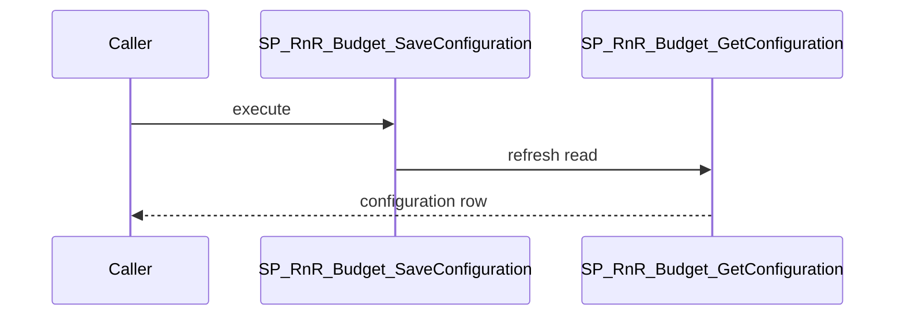
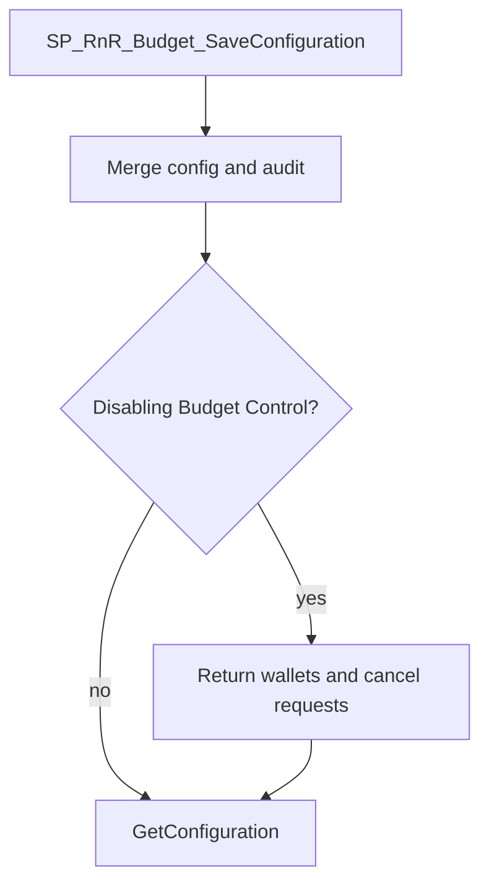

# SP_RnR_Budget_SaveConfiguration

## What it does

Merges employer budget-control settings into `TRnRBudgetConfiguration`, writes an audit JSON snapshot, and when Budget Control is turned off returns remaining give-wallet availability to the organisation pool and cancels pending point requests. Ends by returning the refreshed configuration via `SP_RnR_Budget_GetConfiguration`.

## Parameters

| Name | Direction | What it is for |
|---|---|---|
| `@EmployerId` | in | Employer scope |
| `@BudgetControlEnabled` | in | Budget Control flag |
| `@AllocationExpiryDays` | in | `-1` or 30/90/180/365 |
| `@NewJoinerEnabled` / `@NewJoinerPoints` | in | New-joiner allocation |
| `@PointRequestsEnabled` / `@PointRequestExpiryDays` | in | Point request flags |
| `@ChangedBy` | in | Acting user |

## Call sequence

## Callers

No other procedure executes this object as a nested call (except it self-calls GetConfiguration). App callers: Admin Console Budget Configuration save.

## Nested

| Object | Kind | When |
|---|---|---|
| `SP_RnR_Budget_GetConfiguration` | procedure | always after commit |

## Steps

1. Script is `HRMS-DATABASE/HRMS-RewardNRecognition/STORED_PROCEDURE/SP_RnR_Budget_SaveConfiguration.sql`.
2. Validate expiry enums and non-negative new-joiner points.
3. MERGE configuration; insert audit previous/new JSON.
4. If disabling Budget Control, return wallet points to organisation pool and cancel pending point requests with history.
5. Commit; execute `SP_RnR_Budget_GetConfiguration`.

## Tables

| Table | Read or write |
|---|---|
| `dbo.TRnRBudgetConfiguration` | read/write |
| `dbo.TRnRBudgetConfigurationAudit` | write |
| `dbo.TRnRGiveWalletBatch` / `TRnRGiveWalletMovement` | write when disabling |
| `dbo.TRnROrganisationPool` / `TRnROrganisationPoolMovement` | write when disabling |
| `dbo.TRnRPointRequest` / `TRnRPointRequestStatusHistory` | write when disabling |

## Unresolved calls

None.

## Flow

